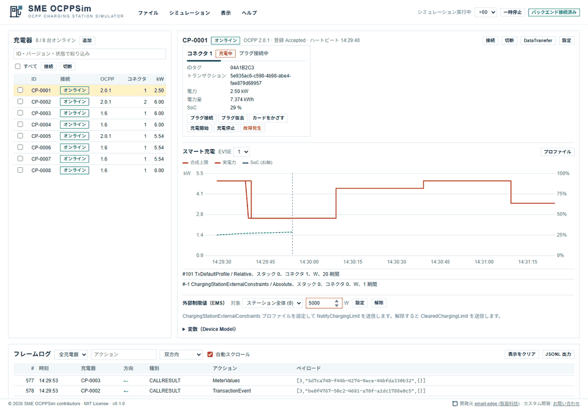
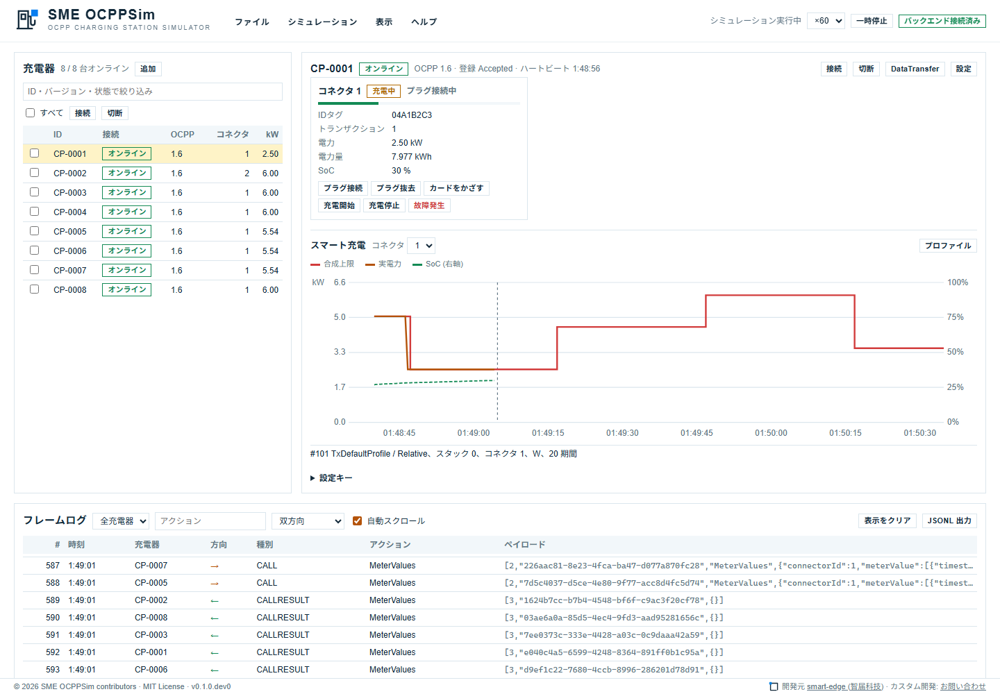
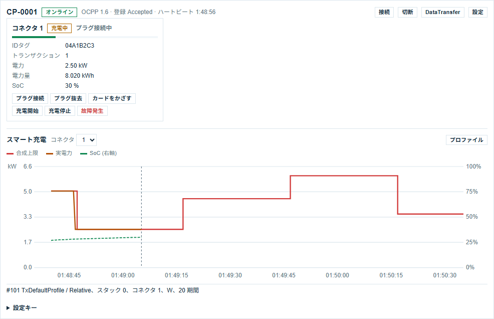
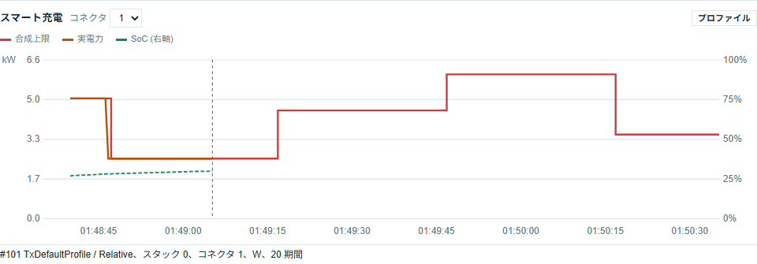
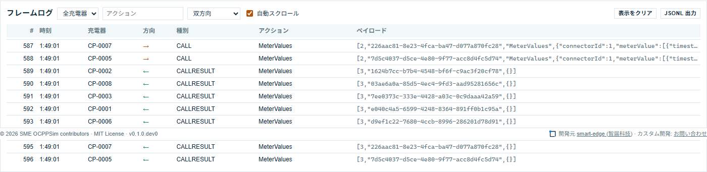
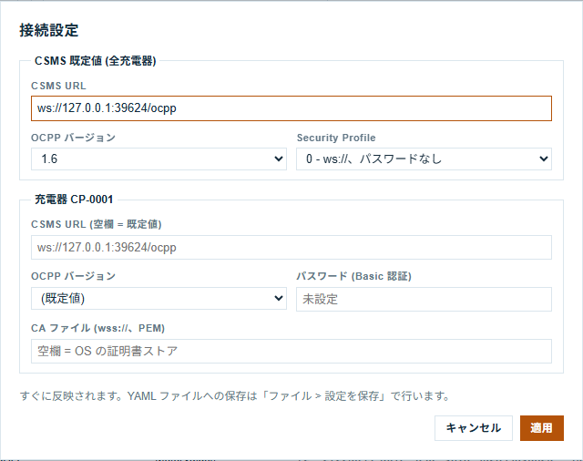
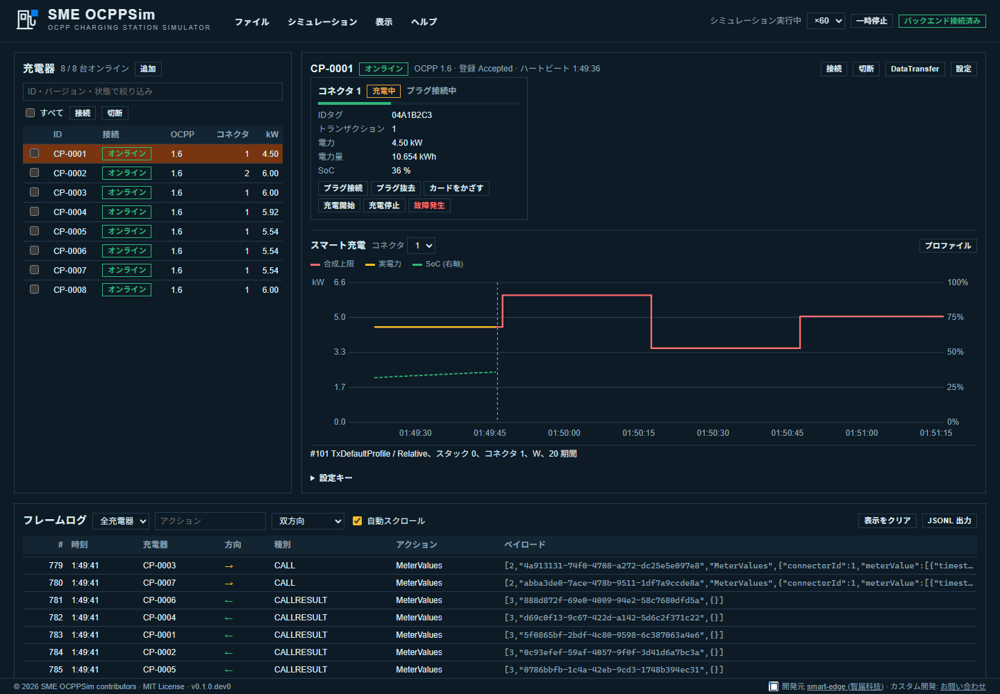

<p align="center"></p>

<h1 align="center">SME OCPPSim</h1>

<p align="center"><strong>ノート PC 1 台で、EV 充電器が並ぶ駐車場をまるごと再現。</strong><br>Smart Charging 対応の OCPP 1.6J 充電器を、CSMS・EMS の試験用にライブ Web UI 付きで。</p>

<p align="center"><a href="https://smartedge-tech.com/open-source/#ocpp-sim"><b>Web サイト</b></a> · <a href="https://smartedge-tech-dev.github.io/sme-ocpp-sim/ja/"><b>ドキュメント</b></a> · <a href="https://github.com/smartedge-tech-dev/sme-ocpp-sim/releases/latest"><b>ダウンロード</b></a></p>

<p align="center"><a href="https://github.com/smartedge-tech-dev/sme-ocpp-sim/actions/workflows/ci.yml"></a> <a href="https://github.com/smartedge-tech-dev/sme-ocpp-sim/releases/latest"></a> <a href="https://github.com/smartedge-tech-dev/sme-ocpp-sim/blob/main/LICENSE"></a>   </p>

<p align="center"><a href="README.md">English</a> | <strong>日本語</strong> | <a href="README.zh-CN.md">简体中文</a></p>

<p align="center"></p>

ライブ Web UI を備えた OCPP 充電器シミュレーターです。数十〜数百台の AC 充電器を模擬し、仮想 EV の接続や
トランザクションの開始・停止を行いながら、CSMS（SteVe、自社の CSMS、EMS など）が送る Smart Charging プロファイルに
充電電力が追従する様子をブラウザ上で確認できます。

- **OCPP 1.6J の充電器。** Boot、Heartbeat、ステータス、Authorize、トランザクション、MeterValues に加え、
  リモート開始・停止、設定、リセット、TriggerMessage、Availability、アンロック、DataTransfer に対応します。
  OCPP 2.0.1 / 2.1 は v0.2 / v0.3 で対応予定です。
- **電力の閉ループを持つ Smart Charging。** SetChargingProfile、ClearChargingProfile、GetCompositeSchedule に対応します。
  電力の制限値は GetCompositeSchedule に応答するのと同じ関数で計算するため、計画と MeterValues が食い違いません。
  仕様が定めていない点の解釈はすべてドキュメントに記載しています。
- **EV と電力のモデル。** 電池、SoC、充電カーブ、相数、ランプ、日本の 200 V 単相・三相デルタ電源を扱い、
  Charging / SuspendedEV / SuspendedEVSE はモデルから決まります。
- **1 プロセスで 200 台以上**。個別または一括で接続できます。
- **セキュリティプロファイル 0 / 1 / 2**: `ws://`、HTTP Basic、Basic 認証付き `wss://`。
- **フレームログ** ですべての OCPP フレームを絞り込み・JSON Lines エクスポート。テストスクリプト向けに HTTP API と WebSocket を提供します。
- **YAML 設定** をブラウザで編集し、ファイルへ保存できます。
- **英語、日本語、簡体字中国語。** UI はブラウザの言語に従います。

SME OCPPSim は無償の MIT ライセンスで、[smart-edge (智届科技)](https://smartedge-tech.com) が開発しています —
カスタム開発も承っています。[商用サポートとカスタム開発](#商用サポートとカスタム開発) をご覧ください。

## スクリーンショット

<table>
  <tr>
    <td width="50%"><a href="https://raw.githubusercontent.com/smartedge-tech-dev/sme-ocpp-sim/main/docs/assets/screenshots/ja/overview.png"></a><br><sub>充電器一覧: 接続状態、OCPP バージョン、コネクター数、合計電力</sub></td>
    <td width="50%"><a href="https://raw.githubusercontent.com/smartedge-tech-dev/sme-ocpp-sim/main/docs/assets/screenshots/ja/charger.png"></a><br><sub>コネクターカード: 接続、タグ、開始、停止、故障</sub></td>
  </tr>
  <tr>
    <td width="50%"><a href="https://raw.githubusercontent.com/smartedge-tech-dev/sme-ocpp-sim/main/docs/assets/screenshots/ja/smart-charging.png"></a><br><sub>Smart Charging パネル: 制限値・電力・SoC を同じ時間軸で表示</sub></td>
    <td width="50%"><a href="https://raw.githubusercontent.com/smartedge-tech-dev/sme-ocpp-sim/main/docs/assets/screenshots/ja/frames.png"></a><br><sub>OCPP フレームログ（絞り込みと JSON 詳細）</sub></td>
  </tr>
  <tr>
    <td width="50%"><a href="https://raw.githubusercontent.com/smartedge-tech-dev/sme-ocpp-sim/main/docs/assets/screenshots/ja/settings.png"></a><br><sub>設定: CSMS URL、OCPP バージョン、セキュリティプロファイル</sub></td>
    <td width="50%"><a href="https://raw.githubusercontent.com/smartedge-tech-dev/sme-ocpp-sim/main/docs/assets/screenshots/ja/overview-dark.png"></a><br><sub>ダークテーマ</sub></td>
  </tr>
</table>

## クイックスタート

[最新リリース](https://github.com/smartedge-tech-dev/sme-ocpp-sim/releases/latest) から Windows 実行ファイルをダウンロードするか、pip でインストールします（Python 3.11 以降）。

```powershell
python -m venv .venv
.venv\Scripts\pip install sme-ocpp-sim
.venv\Scripts\sme-ocpp-sim -c configs/demo-site.yaml
```

Docker イメージ（linux/amd64、linux/arm64）も使えます。

```bash
docker run --rm -p 8082:8082 --add-host=host.docker.internal:host-gateway ghcr.io/smartedge-tech-dev/sme-ocpp-sim
```

<http://127.0.0.1:8082/> を開きます。デモ設定では 3 台の充電器が `ws://localhost:8180/steve/websocket/CentralSystemService`
の SteVe に接続します。Docker から接続する場合は `localhost` の代わりに `host.docker.internal` を使ってください。
SteVe の準備とすべてのオプションは [クイックスタート](https://smartedge-tech-dev.github.io/sme-ocpp-sim/ja/quick-start/) をご覧ください。

## ドキュメント

- [設定](https://smartedge-tech-dev.github.io/sme-ocpp-sim/ja/configuration/) — YAML の全フィールド。UI から保存すると `chargers:` ブロック全体を書き直すため、
  個々の充電器エントリの中にはコメントを書かないでください。
- [OCPP 1.6J メッセージ](https://smartedge-tech-dev.github.io/sme-ocpp-sim/ja/messages/) — 対応・非対応のアクション
- [Smart Charging](https://smartedge-tech-dev.github.io/sme-ocpp-sim/ja/smart-charging/) — ルールと本実装での解釈
- [セキュリティプロファイル](https://smartedge-tech-dev.github.io/sme-ocpp-sim/ja/security-profiles/)
- [HTTP API](https://smartedge-tech-dev.github.io/sme-ocpp-sim/ja/http-api/) — REST ルートと `/ws` の仕様
- [開発](https://smartedge-tech-dev.github.io/sme-ocpp-sim/ja/development/)
- [変更履歴](CHANGELOG.md)

SME OCPPSim は Open Charge Alliance が公開している OCPP 仕様に基づいて実装しています。OCA の認証は受けておらず、
OCTT による試験も行っていません。

## 商用サポートとカスタム開発

SME OCPPSim は **smart-edge** — 南京智届科技有限公司（Nanjing Smart-Edge Technology Co., Ltd.、智届科技）が開発しています。
同社は 2023 年の創業以来、太陽光、蓄電池、EV などの分散型エネルギーリソース向けに、機器制御から
クラウド、電力市場までのエンドツーエンドのソフトウェアを開発してきました。製品には、
AERIS RA プラットフォーム（リソースアグリゲーター向け）と、日本の電力市場向けの AC システム（アグリゲーションコーディネーター）が
あります。チームは日本語でプロジェクトをサポートしており、要件定義から
設計、実装、運用・保守まで対応します。

サービス:

- エネルギーマネジメントシステム（EMS）、クラウドおよびオンサイト
- 電力市場向けの RA / AC システム（JEPX、EPRX、OCCTO）
- エッジ IoT および機器制御ソフトウェア
- 機器連携: Modbus、MQTT、BACnet、ECHONET Lite、OpenADR 2.0b
- エネルギー予測とデータ分析
- クラウドインフラの設計・構築・運用

SME OCPPSim への機能追加や、お使いのデバイスまたは EMS との連携支援が必要ですか？ お気軽にお問い合わせください:

- Web サイト: <https://smartedge-tech.com>
- お問い合わせページ: <https://smartedge-tech.com/contact/>
- E-mail: [business@smartedge-tech.com](mailto:business@smartedge-tech.com)

## ライセンス

[MIT](LICENSE)
