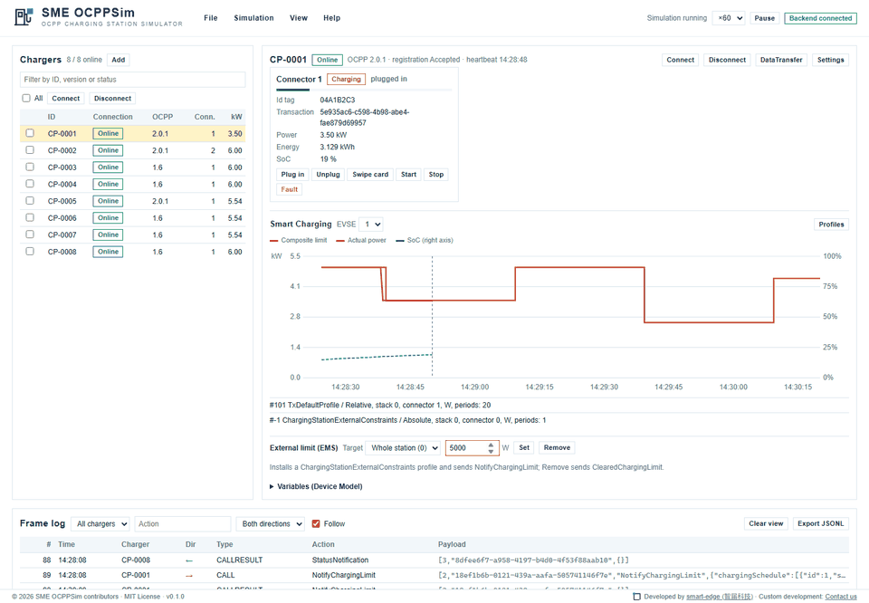
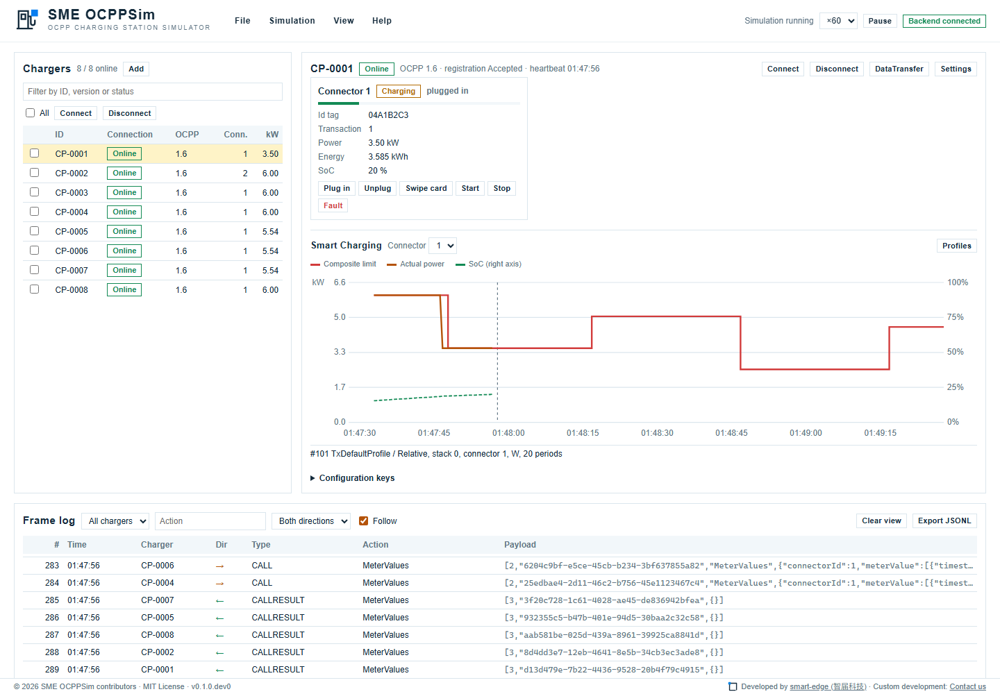
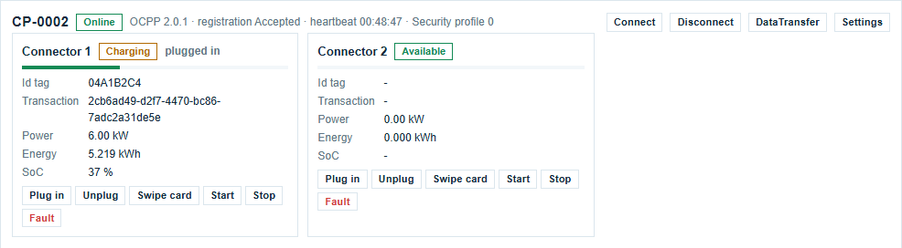
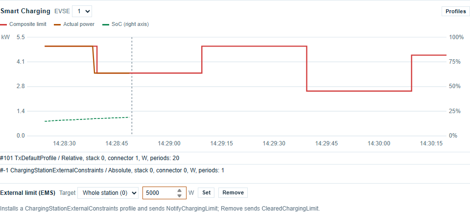
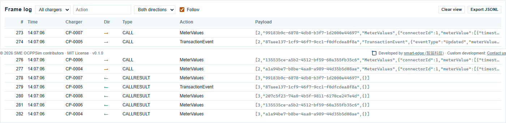
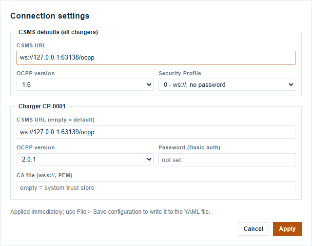
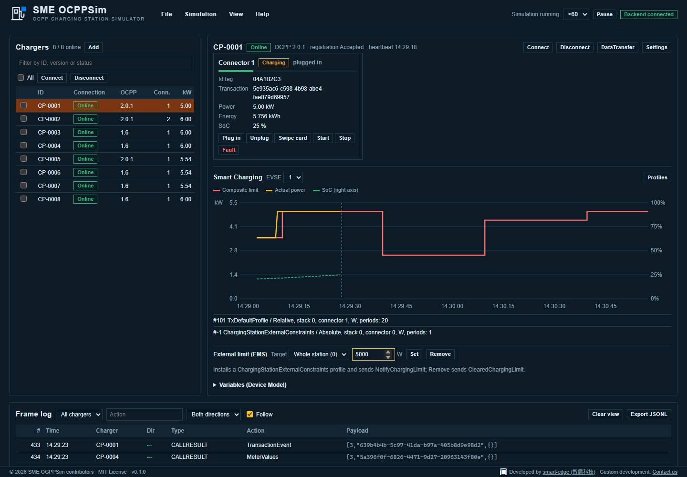
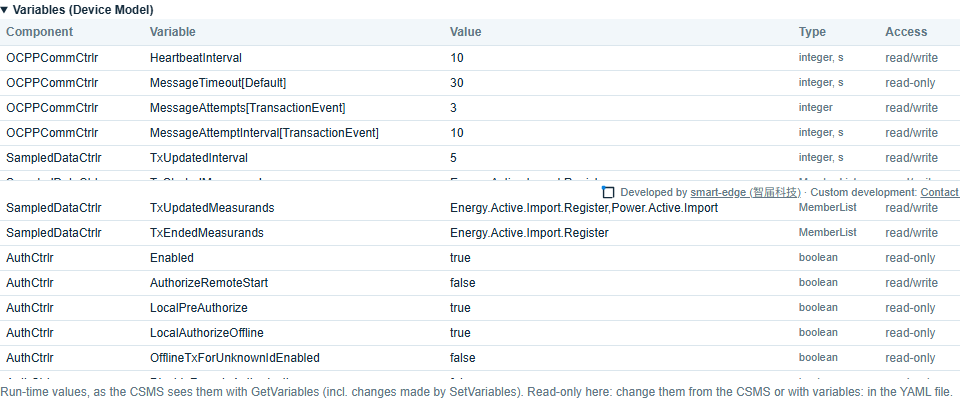
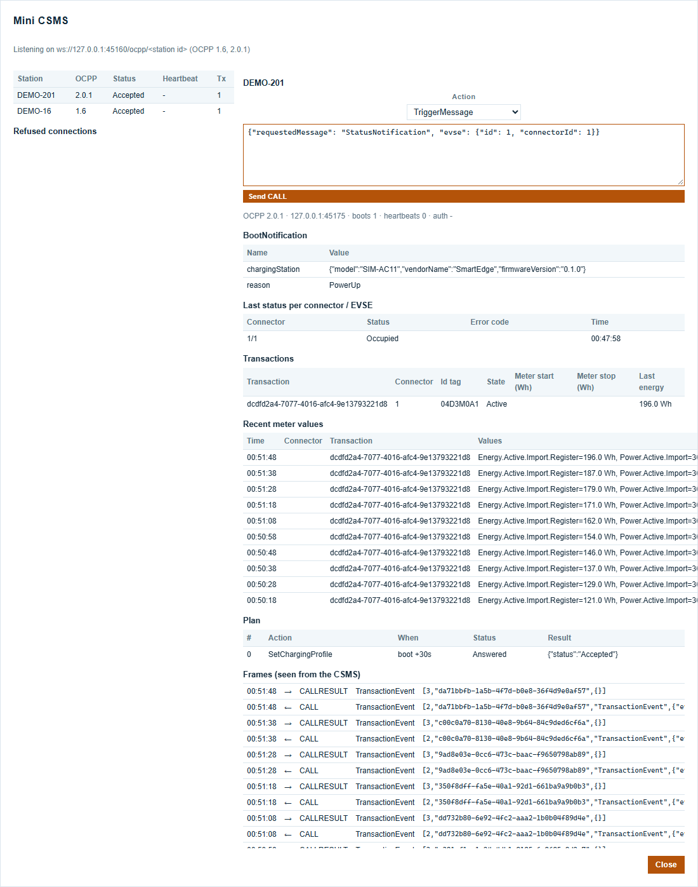
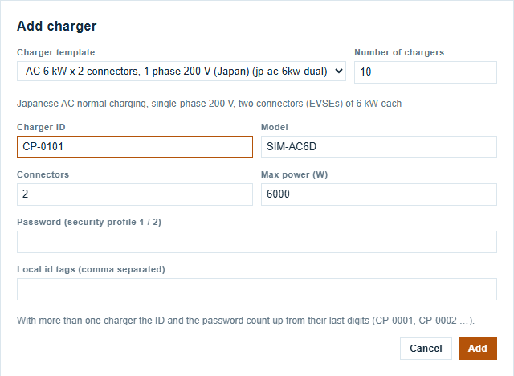

<p align="center"></p>

<h1 align="center">SME OCPPSim</h1>

<p align="center"><strong>Simulate a car park full of EV chargers on your laptop.</strong> OCPP 1.6J and 2.0.1 chargers with Smart Charging,<br>for CSMS and EMS testing, with a live web UI.</p>

<p align="center"><a href="https://smartedge-tech.com/open-source/#ocpp-sim"><b>Website</b></a> · <a href="https://smartedge-tech-dev.github.io/sme-ocpp-sim/"><b>Docs</b></a> · <a href="https://github.com/smartedge-tech-dev/sme-ocpp-sim/releases/latest"><b>Download</b></a></p>

<p align="center"><a href="https://github.com/smartedge-tech-dev/sme-ocpp-sim/actions/workflows/ci.yml"></a> <a href="https://github.com/smartedge-tech-dev/sme-ocpp-sim/releases/latest"></a> <a href="https://github.com/smartedge-tech-dev/sme-ocpp-sim/blob/main/LICENSE"></a>   </p>

<p align="center"><strong>English</strong> | <a href="README.ja.md">日本語</a> | <a href="README.zh-CN.md">简体中文</a></p>

<p align="center"></p>

A free, open-source OCPP charging station simulator (a charge point / EV charger simulator) with a live web UI,
for Windows, Linux and Docker. Simulate dozens to hundreds of AC chargers, plug in
virtual EVs, start and stop transactions, and watch the charging power follow the Smart Charging profiles your
CSMS (SteVe, your own CSMS, an EMS...) sends.

- **OCPP 1.6J charge points.** Boot, heartbeat, status, authorize, transactions and meter values; remote
  start / stop, configuration, reset, trigger message, availability, unlock and data transfer.
- **OCPP 2.0.1 charging stations**, mixed freely with 1.6 chargers: TransactionEvent with offline queueing,
  RequestStart / StopTransaction, Reset, ChangeAvailability, TriggerMessage, UnlockConnector, the Device Model
  (GetVariables / SetVariables / GetBaseReport, shown read-only in the UI) and 2.0.1 Smart Charging with an
  external (EMS) limit. OCPP 2.1 is planned for v0.3.
- **Smart Charging with a closed power loop (1.6 and 2.0.1).** SetChargingProfile, ClearChargingProfile and
  GetCompositeSchedule. The power limit is computed by the same function that answers GetCompositeSchedule,
  so the schedule and the meter values cannot diverge. Every point the specification leaves open is documented.
- **EV and power model.** Battery, SoC, charging curve, phases, ramps, Japanese 200 V single-phase and
  3-phase delta supplies; Charging / SuspendedEV / SuspendedEVSE follow from the model.
- **200+ chargers in one process**, connected individually or in bulk.
- **Authorization, reservations and maintenance (1.6 and 2.0.1).** Local authorization list and
  authorization cache, ReserveNow / CancelReservation, and simulated firmware update, diagnostics and log
  upload with status notifications and failure injection.
- **Security profiles 0 / 1 / 2 / 3**: `ws://`, HTTP Basic, `wss://` with Basic, `wss://` with a TLS client
  certificate; certificate management (SignCertificate with a generated CSR, CertificateSigned,
  InstallCertificate ...) and SecurityEventNotification.
- **Built-in Mini CSMS** (port 9000): a simple OCPP 1.6J / 2.0.1 CSMS in the same process, to try the
  simulator without SteVe, see what the stations send and send any CALL from a JSON editor.
- **Excel import / export and charger templates.** Edit the charger list in Excel, or add N chargers at
  once from a built-in or your own template.
- **Frame log** of every OCPP frame with filters and JSON Lines export; HTTP API and WebSocket for test scripts, and an MCP endpoint for AI assistants.
- **YAML configuration**, edited in the browser and saved back to the file (the Windows exe keeps it in
  `~/.sme-ocpp-sim/config.yaml`).
- **English, Japanese and Simplified Chinese.** The UI follows the browser language.

SME OCPPSim is free and MIT-licensed, developed by [smart-edge (智届科技)](https://smartedge-tech.com) —
custom development is available, see [Commercial support & custom development](#commercial-support--custom-development).

## Screenshots

<table>
  <tr>
    <td width="50%"><a href="https://raw.githubusercontent.com/smartedge-tech-dev/sme-ocpp-sim/main/docs/assets/screenshots/en/overview.png"></a><br><sub>Charger list: connection, OCPP version, connectors and total power</sub></td>
    <td width="50%"><a href="https://raw.githubusercontent.com/smartedge-tech-dev/sme-ocpp-sim/main/docs/assets/screenshots/en/charger.png"></a><br><sub>An OCPP 2.0.1 charger: EVSE cards with plug, swipe, start, stop and fault</sub></td>
  </tr>
  <tr>
    <td width="50%"><a href="https://raw.githubusercontent.com/smartedge-tech-dev/sme-ocpp-sim/main/docs/assets/screenshots/en/smart-charging.png"></a><br><sub>Smart Charging panel: limit, power and SoC on one time axis, with the 2.0.1 external limit</sub></td>
    <td width="50%"><a href="https://raw.githubusercontent.com/smartedge-tech-dev/sme-ocpp-sim/main/docs/assets/screenshots/en/frames.png"></a><br><sub>OCPP frame log with filters and JSON detail</sub></td>
  </tr>
  <tr>
    <td width="50%"><a href="https://raw.githubusercontent.com/smartedge-tech-dev/sme-ocpp-sim/main/docs/assets/screenshots/en/settings.png"></a><br><sub>Settings: CSMS URL, OCPP version and security profile</sub></td>
    <td width="50%"><a href="https://raw.githubusercontent.com/smartedge-tech-dev/sme-ocpp-sim/main/docs/assets/screenshots/en/overview-dark.png"></a><br><sub>Dark theme</sub></td>
  </tr>
  <tr>
    <td width="50%"><a href="https://raw.githubusercontent.com/smartedge-tech-dev/sme-ocpp-sim/main/docs/assets/screenshots/en/variables.png"></a><br><sub>OCPP 2.0.1 Device Model variables (read-only)</sub></td>
    <td width="50%"><a href="https://raw.githubusercontent.com/smartedge-tech-dev/sme-ocpp-sim/main/docs/assets/screenshots/en/mini-csms.png"></a><br><sub>Mini CSMS: the built-in CSMS with the connected stations, their records and a JSON editor for any CALL</sub></td>
  </tr>
  <tr>
    <td width="50%"><a href="https://raw.githubusercontent.com/smartedge-tech-dev/sme-ocpp-sim/main/docs/assets/screenshots/en/add-charger.png"></a><br><sub>Add charger: several chargers at once from a charger template</sub></td>
    <td width="50%"><sub>Mixed 1.6 / 2.0.1 sites: see <code>configs/mixed-site.yaml</code></sub></td>
  </tr>
</table>

## Quick start

Download the Windows executable from the [latest release](https://github.com/smartedge-tech-dev/sme-ocpp-sim/releases/latest), or install with pip
(Python 3.11+):

```powershell
python -m venv .venv
.venv\Scripts\pip install sme-ocpp-sim
.venv\Scripts\sme-ocpp-sim -c configs/demo-site.yaml
```

or run the Docker image (linux/amd64, linux/arm64):

```bash
docker run --rm -p 8082:8082 --add-host=host.docker.internal:host-gateway ghcr.io/smartedge-tech-dev/sme-ocpp-sim
```

Open <http://127.0.0.1:8082/>. The demo configuration connects three chargers to a SteVe CSMS at
`ws://localhost:8180/steve/websocket/CentralSystemService`; from Docker use `host.docker.internal` instead of
`localhost`. See the [quick start](https://smartedge-tech-dev.github.io/sme-ocpp-sim/quick-start/) for SteVe setup and all options.

## Documentation

- [Configuration](https://smartedge-tech-dev.github.io/sme-ocpp-sim/configuration/) — every YAML field. Saving from the UI rewrites the whole `chargers:`
  block, so don't put comments inside individual charger entries.
- [OCPP messages](https://smartedge-tech-dev.github.io/sme-ocpp-sim/messages/) — supported and unsupported 1.6J / 2.0.1 actions
- [Smart Charging](https://smartedge-tech-dev.github.io/sme-ocpp-sim/smart-charging/) — rules and the interpretations in this implementation
- [Security profiles](https://smartedge-tech-dev.github.io/sme-ocpp-sim/security-profiles/) — profiles 0 to 3 and certificate management
- [Mini CSMS](https://smartedge-tech-dev.github.io/sme-ocpp-sim/mini-csms/) — the built-in CSMS on port 9000
- [Excel & charger templates](https://smartedge-tech-dev.github.io/sme-ocpp-sim/excel-templates/) — import / export and bulk add from a template
- [HTTP API](https://smartedge-tech-dev.github.io/sme-ocpp-sim/http-api/) — REST routes and the `/ws` contract
- [MCP, health check and logs](https://smartedge-tech-dev.github.io/sme-ocpp-sim/mcp/) — drive the chargers from an AI assistant (`/mcp`), `/healthz`, `--log-format json`
- [Development](https://smartedge-tech-dev.github.io/sme-ocpp-sim/development/)
- [Changelog](CHANGELOG.md)

SME OCPPSim implements the publicly available OCPP specification of the Open Charge Alliance. It is not OCA
certified and has not been tested with OCTT.

## More simulators from smart-edge

SME OCPPSim is one of a series of free, MIT-licensed protocol simulators by smart-edge. They share the
same web UI and conventions, so what you learn in one carries over to the others.

| Simulator | What it simulates | Docs |
|---|---|---|
| [SME BACnetSim](https://github.com/smartedge-tech-dev/sme-bacnet-sim) | BACnet/IP device simulator | [Docs](https://smartedge-tech-dev.github.io/sme-bacnet-sim/) |
| [SME ModbusSim](https://github.com/smartedge-tech-dev/sme-modbus-sim) | Modbus TCP / RTU / UDP / TLS slave (server) simulator | [Docs](https://smartedge-tech-dev.github.io/sme-modbus-sim/) |
| **SME OCPPSim** (this project) | OCPP 1.6J / 2.0.1 charging station (charge point) simulator | [Docs](https://smartedge-tech-dev.github.io/sme-ocpp-sim/) |

All open-source tools from smart-edge: <https://smartedge-tech.com/open-source/>

## Commercial support & custom development

SME OCPPSim is developed by **smart-edge** — Nanjing Smart-Edge Technology Co., Ltd. (南京智届科技有限公司, 智届科技).
Since its founding in 2023 the company has developed end-to-end software for distributed energy resources
such as solar, batteries and EVs, from equipment control to the cloud and electricity markets. Its products
include the AERIS RA platform (リソースアグリゲーター向け) and an AC system (アグリゲーションコーディネーター) for
the Japanese electricity markets. The team supports projects in Japanese, from requirements definition
through design, implementation, operation and maintenance.

Services:

- Energy management systems (EMS), cloud and on-site
- RA / AC systems for electricity markets (JEPX, EPRX, OCCTO)
- Edge IoT and equipment-control software
- Equipment integration: Modbus, MQTT, BACnet, ECHONET Lite, OpenADR 2.0b
- Energy forecasting and data analytics
- Cloud infrastructure design, build and operation

Need a feature added to SME OCPPSim, or help integrating your devices or EMS? Get in touch:

- Website: <https://smartedge-tech.com>
- Contact page: <https://smartedge-tech.com/contact/>
- E-mail: [business@smartedge-tech.com](mailto:business@smartedge-tech.com)

## License

[MIT](LICENSE)
