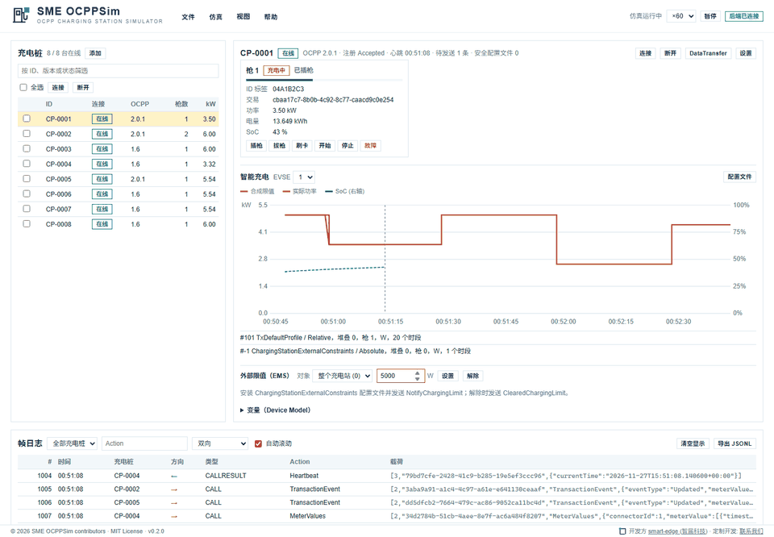
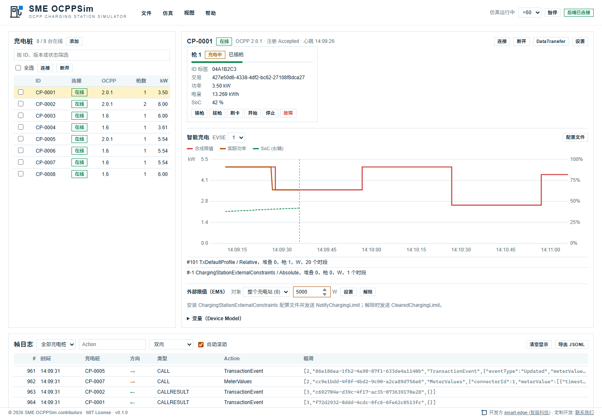
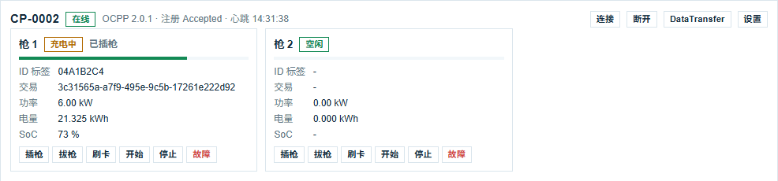
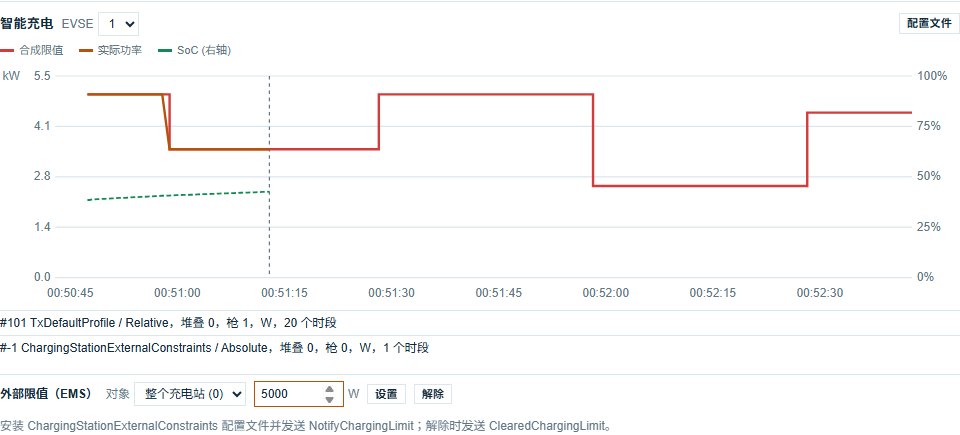
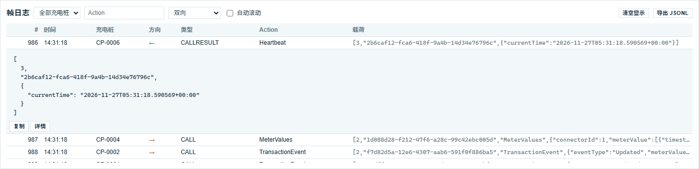
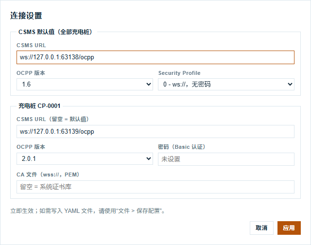
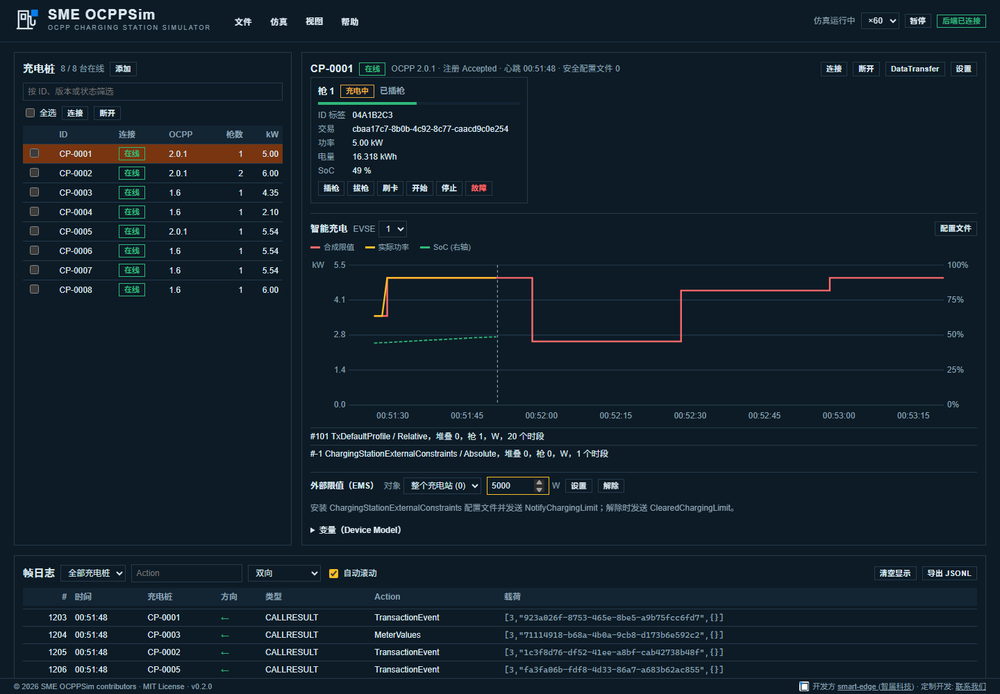
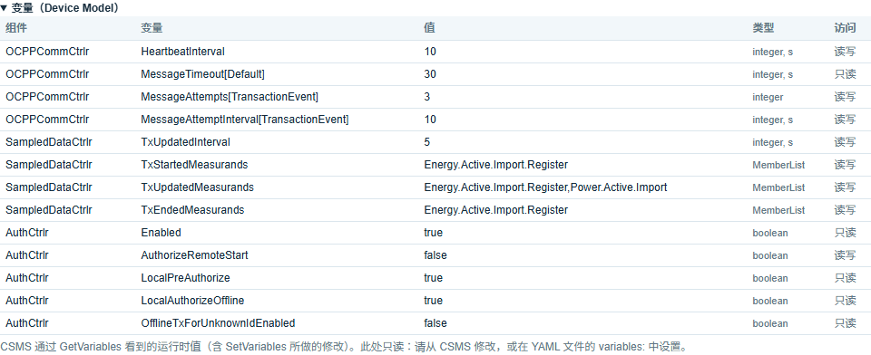
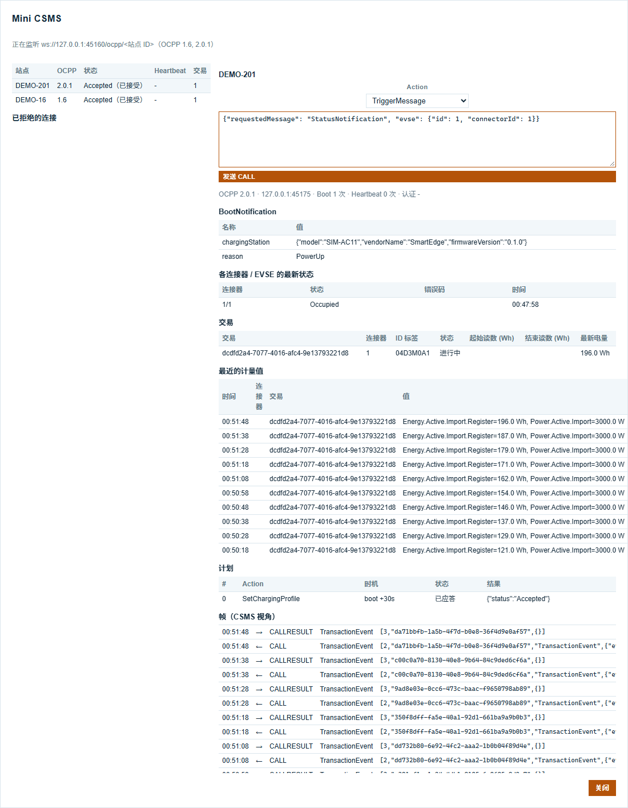
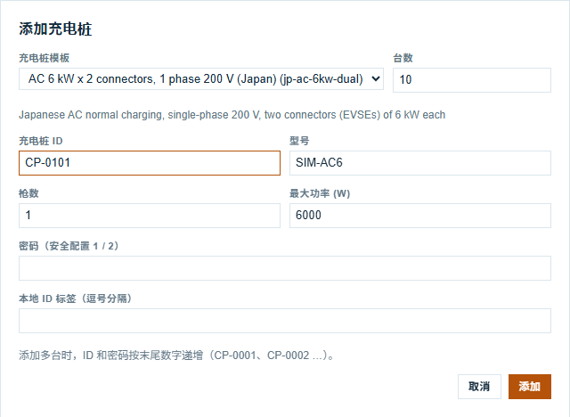

<p align="center"></p>

<h1 align="center">SME OCPPSim</h1>

<p align="center"><strong>一台电脑，模拟整个充电场站。</strong><br>支持 Smart Charging 的 OCPP 1.6J / 2.0.1 充电桩，用于 CSMS 与 EMS 测试，附带实时 Web UI。</p>

<p align="center"><a href="https://smartedge-tech.com/zh/open-source/#ocpp-sim"><b>官网</b></a> · <a href="https://smartedge-tech-dev.github.io/sme-ocpp-sim/zh/"><b>文档</b></a> · <a href="https://github.com/smartedge-tech-dev/sme-ocpp-sim/releases/latest"><b>下载</b></a></p>

<p align="center"><a href="https://github.com/smartedge-tech-dev/sme-ocpp-sim/actions/workflows/ci.yml"></a> <a href="https://github.com/smartedge-tech-dev/sme-ocpp-sim/releases/latest"></a> <a href="https://github.com/smartedge-tech-dev/sme-ocpp-sim/blob/main/LICENSE"></a>   </p>

<p align="center"><a href="README.md">English</a> | <a href="README.ja.md">日本語</a> | <strong>简体中文</strong></p>

<p align="center"></p>

一个免费开源、带实时 Web UI 的 OCPP 充电桩模拟器（仿真软件），支持 Windows、Linux 和 Docker。可以模拟几十到几百台 AC 充电桩，插入虚拟 EV、启动和停止交易，并在浏览器中观察充电功率如何跟随 CSMS（SteVe、你自己的 CSMS、EMS……）下发的 Smart Charging profile 变化。

- **OCPP 1.6J 充电桩。** Boot、Heartbeat、状态、Authorize、交易和 MeterValues；远程启动 / 停止、配置、复位、TriggerMessage、可用性、解锁和 DataTransfer。
- **OCPP 2.0.1 充电站**，可与 1.6 充电桩任意混合：带离线队列的 TransactionEvent、RequestStart / StopTransaction、Reset、ChangeAvailability、TriggerMessage、UnlockConnector、Device Model（GetVariables / SetVariables / GetBaseReport，UI 中只读显示），以及带外部（EMS）限值的 2.0.1 Smart Charging。也支持 OCPP 2.1 核心（SEND / CALLRESULTERROR 帧格式，新增 2.1 消息的存储与应答）。
- **功率闭环的 Smart Charging。** 支持 SetChargingProfile、ClearChargingProfile 和 GetCompositeSchedule。功率限值与应答 GetCompositeSchedule 的是同一个函数，计划与 MeterValues 不会不一致。规范未明确之处的解释全部写在文档中。
- **EV 与功率模型。** 电池、SoC、充电曲线、相数、爬坡，以及日本 200 V 单相和三相三角形接法供电；Charging / SuspendedEV / SuspendedEVSE 由模型决定。
- **单进程 200 台以上**，可单独或批量连接。
- **认证、预约与维护（1.6 与 2.0.1）。** 本地授权列表与授权缓存、ReserveNow / CancelReservation，以及带状态通知和故障注入的固件升级、诊断 / 日志上传模拟。
- **Security Profile 0 / 1 / 2 / 3**：`ws://`、HTTP Basic、带 Basic 认证的 `wss://`、带 TLS 客户端证书的 `wss://`；证书管理（用生成的 CSR 进行 SignCertificate、CertificateSigned、InstallCertificate 等）和 SecurityEventNotification。
- **内置 Mini CSMS**（端口 9000）：在同一进程中运行的简易 OCPP 1.6J / 2.0.1 CSMS，无需 SteVe 即可试用，可查看充电站上报的内容，并用 JSON 编辑器发送任意 CALL。
- **Excel 导入 / 导出与充电桩模板。** 在 Excel 中编辑充电桩列表，或从内置或自定义模板一次添加 N 台。
- **帧日志** 记录每一个 OCPP 帧，可过滤并导出 JSON Lines；为测试脚本提供 HTTP API 和 WebSocket，为 AI 助手提供 MCP 端点。
- **场景与流量（v0.3）。** 用 YAML 编写测试场景（模拟时钟上的并行轨道，数小时只需数秒），以 JSON 或 JUnit
  输出通过 / 失败判定；可从 CLI（`scenario run`，内置示例用 `builtin:<名称>`）、HTTP API、MCP 或场景面板运行。
  另有带 seed 的随机流量生成器（常驻负载）、带权重的车辆档案池，以及连接故障之外的异常开关（接受 RemoteStart
  但不开始交易、电表值丢弃 / 乱序 / 噪声、慢应答）。
- **YAML 配置**，可在浏览器中编辑并保存回文件（Windows exe 保存在 `~/.sme-ocpp-sim/config.yaml`）。
- **英语、日语和简体中文。** UI 跟随浏览器语言。

SME OCPPSim 免费且采用 MIT 许可证，由 [smart-edge (智届科技)](https://smartedge-tech.com) 开发——可提供定制开发，详见 [商业支持与定制开发](#商业支持与定制开发)。

## 截图

<table>
  <tr>
    <td width="50%"><a href="https://raw.githubusercontent.com/smartedge-tech-dev/sme-ocpp-sim/main/docs/assets/screenshots/zh/overview.png"></a><br><sub>充电桩列表：连接状态、OCPP 版本、connector 数和总功率</sub></td>
    <td width="50%"><a href="https://raw.githubusercontent.com/smartedge-tech-dev/sme-ocpp-sim/main/docs/assets/screenshots/zh/charger.png"></a><br><sub>Connector 卡片：插枪、刷卡、启动、停止和故障</sub></td>
  </tr>
  <tr>
    <td width="50%"><a href="https://raw.githubusercontent.com/smartedge-tech-dev/sme-ocpp-sim/main/docs/assets/screenshots/zh/smart-charging.png"></a><br><sub>Smart Charging 面板：限值、功率和 SoC 共用同一时间轴</sub></td>
    <td width="50%"><a href="https://raw.githubusercontent.com/smartedge-tech-dev/sme-ocpp-sim/main/docs/assets/screenshots/zh/frames.png"></a><br><sub>OCPP 帧日志（过滤与 JSON 详情）</sub></td>
  </tr>
  <tr>
    <td width="50%"><a href="https://raw.githubusercontent.com/smartedge-tech-dev/sme-ocpp-sim/main/docs/assets/screenshots/zh/settings.png"></a><br><sub>设置：CSMS URL、OCPP 版本和 Security Profile</sub></td>
    <td width="50%"><a href="https://raw.githubusercontent.com/smartedge-tech-dev/sme-ocpp-sim/main/docs/assets/screenshots/zh/overview-dark.png"></a><br><sub>深色主题</sub></td>
  </tr>
  <tr>
    <td width="50%"><a href="https://raw.githubusercontent.com/smartedge-tech-dev/sme-ocpp-sim/main/docs/assets/screenshots/zh/variables.png"></a><br><sub>OCPP 2.0.1 Device Model 变量（只读）</sub></td>
    <td width="50%"><a href="https://raw.githubusercontent.com/smartedge-tech-dev/sme-ocpp-sim/main/docs/assets/screenshots/zh/mini-csms.png"></a><br><sub>Mini CSMS：内置 CSMS，显示已连接的充电站及其记录，可用 JSON 编辑器发送任意 CALL</sub></td>
  </tr>
  <tr>
    <td width="50%"><a href="https://raw.githubusercontent.com/smartedge-tech-dev/sme-ocpp-sim/main/docs/assets/screenshots/zh/add-charger.png"></a><br><sub>添加充电桩：从充电桩模板一次添加多台</sub></td>
    <td width="50%"><sub>1.6 / 2.0.1 混合站点示例：<code>configs/mixed-site.yaml</code></sub></td>
  </tr>
</table>

## 快速开始

从 [最新发布](https://github.com/smartedge-tech-dev/sme-ocpp-sim/releases/latest) 下载 Windows 可执行文件，或用 pip 安装（Python 3.11+）：

```powershell
python -m venv .venv
.venv\Scripts\pip install sme-ocpp-sim
.venv\Scripts\sme-ocpp-sim -c configs/demo-site.yaml
```

也可以运行 Docker 镜像（linux/amd64、linux/arm64）：

```bash
docker run --rm -p 8082:8082 --add-host=host.docker.internal:host-gateway ghcr.io/smartedge-tech-dev/sme-ocpp-sim
```

打开 <http://127.0.0.1:8082/>。演示配置让三台充电桩连接 `ws://localhost:8180/steve/websocket/CentralSystemService` 上的 SteVe；在 Docker 中请用 `host.docker.internal` 代替 `localhost`。SteVe 的准备和全部选项见 [快速开始](https://smartedge-tech-dev.github.io/sme-ocpp-sim/zh/quick-start/)。

## 文档

- [配置](https://smartedge-tech-dev.github.io/sme-ocpp-sim/zh/configuration/)——YAML 的全部字段。从 UI 保存会重写整个 `chargers:` 块，所以不要在单台充电桩的条目里写注释。
- [OCPP 消息](https://smartedge-tech-dev.github.io/sme-ocpp-sim/zh/messages/)——1.6J / 2.0.1 支持与不支持的 action
- [Smart Charging](https://smartedge-tech-dev.github.io/sme-ocpp-sim/zh/smart-charging/)——规则与本实现的解释
- [安全配置文件](https://smartedge-tech-dev.github.io/sme-ocpp-sim/zh/security-profiles/)——Profile 0〜3 与证书管理
- [Mini CSMS](https://smartedge-tech-dev.github.io/sme-ocpp-sim/zh/mini-csms/)——端口 9000 上的内置 CSMS
- [Excel 与充电桩模板](https://smartedge-tech-dev.github.io/sme-ocpp-sim/zh/excel-templates/)——导入 / 导出与从模板批量添加
- [HTTP API](https://smartedge-tech-dev.github.io/sme-ocpp-sim/zh/http-api/)——REST 路由与 `/ws` 约定
- [场景](https://smartedge-tech-dev.github.io/sme-ocpp-sim/zh/scenarios/)——场景文件、判定、内置示例、`scenario run`
- [流量生成器](https://smartedge-tech-dev.github.io/sme-ocpp-sim/zh/traffic/)——带 seed 的随机会话，用于常驻负载
- [MCP、健康检查与日志](https://smartedge-tech-dev.github.io/sme-ocpp-sim/zh/mcp/)——从 AI 助手操作充电桩（`/mcp`）、`/healthz`、`--log-format json`
- [开发](https://smartedge-tech-dev.github.io/sme-ocpp-sim/zh/development/)
- [更新日志](CHANGELOG.md)

SME OCPPSim 基于 Open Charge Alliance 公开的 OCPP 规范实现，未经 OCA 认证，也未使用 OCTT 测试。

## smart-edge 模拟器系列

SME OCPPSim 是 smart-edge 免费、MIT 许可的协议模拟器系列之一。各模拟器共用同一套 Web UI 和操作方式，学会一个即可上手其他几个。

| 模拟器 | 模拟对象 | 文档 |
|---|---|---|
| [SME BACnetSim](https://github.com/smartedge-tech-dev/sme-bacnet-sim) | BACnet/IP 设备模拟器 | [文档](https://smartedge-tech-dev.github.io/sme-bacnet-sim/zh/) |
| [SME ModbusSim](https://github.com/smartedge-tech-dev/sme-modbus-sim) | Modbus TCP / RTU / UDP / TLS 从站（Slave）模拟器 | [文档](https://smartedge-tech-dev.github.io/sme-modbus-sim/zh/) |
| **SME OCPPSim**（本项目） | OCPP 1.6J / 2.0.1 充电桩模拟器 | [文档](https://smartedge-tech-dev.github.io/sme-ocpp-sim/zh/) |

smart-edge 全部开源工具：<https://smartedge-tech.com/zh/open-source/>

## 商业支持与定制开发

SME OCPPSim 由 **smart-edge** 开发——南京智届科技有限公司（Nanjing Smart-Edge Technology Co., Ltd.，智届科技）。公司自 2023 年成立以来，开发了面向太阳能、储能电池和电动汽车等分布式能源的端到端软件，覆盖从设备控制到云端和电力市场的全链路。其产品包括 AERIS RA 平台（リソースアグリゲーター向け）和面向日本电力市场的 AC 系统（アグリゲーションコーディネーター）。团队可使用日语支持项目，覆盖从需求定义、设计、实施到运维的全过程。

服务内容：

- 能源管理系统（EMS），云端与本地部署
- 面向电力市场（JEPX、EPRX、OCCTO）的 RA / AC 系统
- 边缘 IoT 与设备控制软件
- 设备集成：Modbus、MQTT、BACnet、ECHONET Lite、OpenADR 2.0b
- 能源预测与数据分析
- 云基础设施的设计、搭建与运维

需要为 SME OCPPSim 增加功能，或需要帮助集成你的设备或 EMS？欢迎联系：

- 网站：<https://smartedge-tech.com>
- 联系页面：<https://smartedge-tech.com/contact/>
- 电子邮件：[business@smartedge-tech.com](mailto:business@smartedge-tech.com)

## 许可证

[MIT](LICENSE)
