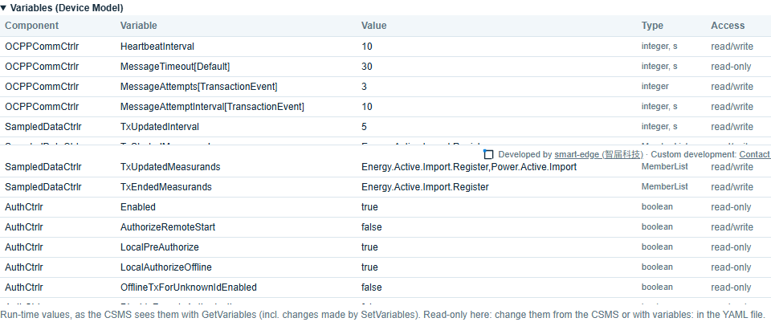

# Configuration

The simulator reads one YAML file (`-c FILE`). Every block is optional; unknown fields are rejected. A complete
example is [`configs/demo-site.yaml`](https://github.com/smartedge-tech-dev/sme-ocpp-sim/blob/main/configs/demo-site.yaml).

```yaml
simulation:
  tick_seconds: 1
  time_scale: 1
  running: true

frame_log:
  size: 20000

csms_defaults:
  url: "ws://localhost:8180/steve/websocket/CentralSystemService"
  ocpp_version: "1.6"
  security_profile: 0
  reconnect: { min_s: 1, max_s: 60, jitter: 0.2 }

ev_models:
  - id: "demo-60kwh"
    capacity_kwh: 60
    max_ac_kw: 11
    max_current_a: 16
    phases: 3

chargers:
  - id: "CP-0001"
    max_power_w: 6000
    id_tags: ["04A1B2C3", "TAG-0002"]
    config_keys:
      HeartbeatInterval: 300
```

!!! warning "Quote ids, tags and passwords"
    In YAML 1.1 unquoted `0123`, `1e5`, `ON`, `OFF`, `yes` and `no` are not strings. Identity and text fields
    (`id`, `id_tags`, `password`, URLs, `vendor`, ...) only accept quoted strings and ask you to add quotes,
    instead of silently turning `0123` into `83`.

## Saving from the web UI { #saving-from-the-web-ui }

Changes made in the UI apply immediately (only the chargers that changed reconnect) and can be saved back to
the YAML file. Saving replaces every top-level block that changed (`simulation`, `frame_log`, `csms_defaults`,
`ev_models`, `chargers`) as a whole:

- Comments **outside** a changed block are kept, as are the file's line endings and a UTF-8 BOM.
- Comments **inside** a changed block are lost. The whole `chargers:` block is rewritten when any charger
  changes, so **don't put comments inside individual charger entries** — put them above the `chargers:` key.
- Values equal to their default are not written out.
- If a block cannot be spliced (unusual layout), the whole document is re-dumped and all comments are lost; a
  warning is logged.

Passwords are never returned by the HTTP API: they appear as `********`. Sending a configuration back with the
mask keeps the stored password.

## simulation

| Field | Default | Meaning |
|---|---|---|
| `tick_seconds` | `1.0` | Step of the power model in seconds (> 0) |
| `time_scale` | `1.0` | Speeds up the power model (ramp, energy register, SoC) only. Charging schedules and OCPP timing always use the wall clock |
| `running` | `true` | `false` freezes the power model; the OCPP sessions keep running |

## frame_log

| Field | Default | Meaning |
|---|---|---|
| `size` | `20000` | OCPP frames kept in memory for all chargers together (≥ 100) |

## csms_defaults

| Field | Default | Meaning |
|---|---|---|
| `url` | none | CSMS WebSocket URL (`ws://` or `wss://`); the charger id is appended as the last path segment. Required unless every charger has `csms_url` |
| `ocpp_version` | `"1.6"` | `"1.6"` or `"2.0.1"`; `"2.1"` is rejected as coming in v0.3 |
| `security_profile` | `0` | `0`, `1`, `2` or `3`; every charger is checked against it, see [Security profiles](security-profiles.md) |
| `reconnect.min_s` | `1.0` | First reconnect delay in seconds |
| `reconnect.max_s` | `60.0` | Maximum reconnect delay (≥ `min_s`); the delay grows exponentially |
| `reconnect.jitter` | `0.2` | Random spread of the delay (0–1) |
| `reconnect.max_retries` | `null` | Consecutive failed connections (a failed handshake, or a connection that closes before an accepted boot) after which the charger gives up: it stops, the UI shows **Gave up**, and only Connect starts it again. `null` = retry forever; `0` = give up on the first failure |

## ev_models

Custom EV models, referenced by `session.ev_model`. An entry overrides a built-in preset with the same id.
Built-in presets: `kei-20kwh` (20 kWh, 3 kW, 15 A, 1 phase), `compact-40kwh` (40 kWh, 6 kW, 30 A, 1 phase),
`midsize-60kwh` (60 kWh, 11 kW, 16 A, 3 phases).

| Field | Default | Meaning |
|---|---|---|
| `id` | required | Unique id (quoted string) |
| `capacity_kwh` | required | Battery capacity |
| `max_ac_kw` | required | Maximum AC charging power |
| `max_current_a` | `32.0` | Maximum current per phase |
| `max_dc_kw` | none | Accepted for forward compatibility; DC charging is not modelled in v0.1 |
| `phases` | `1` | Phases the on-board charger uses (1, 2 or 3) |
| `min_current_a` | `6.0` | Below this current per phase the EV cannot charge (≤ `max_current_a`) |
| `efficiency` | `0.9` | Fraction of the energy that reaches the battery (0–1] |
| `curve` | built-in | List of `[SoC %, fraction of maximum]` pairs: the charging taper |

## chargers

| Field | Default | Meaning |
|---|---|---|
| `id` | required | Charge point id (quoted string). Used as the last URL path segment and as the Basic auth user-id, so it must not contain `:`; `bulk` is reserved |
| `csms_url` | `csms_defaults.url` | Per-charger CSMS URL |
| `ocpp_version` | `csms_defaults.ocpp_version` | Per-charger OCPP version (`"1.6"` or `"2.0.1"`); one site may mix both |
| `password` | none | Basic auth password (security profile 1 / 2) |
| `ca_file` | system trust store | Extra CA bundle (PEM) to verify the CSMS certificate on `wss://` |
| `client_cert_file` | none | Security profile 3: the charger's TLS client certificate (PEM, a chain is allowed) |
| `client_key_file` | none | Security profile 3: its private key (PEM, not encrypted) |
| `verify_tls` | `true` | `false` skips certificate verification (testing only; a warning is logged) |
| `require_subprotocol` | `true` | `false` keeps the connection when the CSMS does not echo the `ocpp1.6` / `ocpp2.0.1` subprotocol |
| `vendor` | `"SmartEdge"` | BootNotification `chargePointVendor` (max. 20 characters) |
| `model` | `"SIM-AC6"` | `chargePointModel` (max. 20) |
| `serial` | none | `chargePointSerialNumber` (max. 25) |
| `firmware` | `"0.1.0"` | `firmwareVersion` (max. 50) |
| `connectors` | `1` | Number of connectors (1–32); all share the supply settings and `max_power_w` below. OCPP 2.0.1: the number of EVSEs, each with one connector |
| `config_keys` | `{}` | OCPP 1.6: initial configuration keys, e.g. `HeartbeatInterval: 300`; numbers and booleans may be unquoted. Not used by a 2.0.1 charger (see `variables`). `AuthorizationKey` cannot be set here (it is the `password`); the Security Whitepaper keys `SecurityProfile` (read-only, the profile in use), `CpoName` (default `vendor`), `CertificateStoreMaxLength` and `AdditionalRootCertificateCheck` (`false`) are |
| `auth_mode` | `local_then_csms` | `local_only` (only `id_tags`), `csms_only` (always Authorize), `local_then_csms` (`id_tags` first, then Authorize), `accept_all` |
| `id_tags` | `[]` | Locally accepted id tags (max. 20 characters each, no duplicates) |
| `boot_retry_s` | `60.0` | Boot retry delay when the CSMS answers Pending / Rejected with interval 0 |
| `boot_max_retries` | `null` | Non-Accepted BootNotification answers (Pending, Rejected or no answer, counted across reconnects until Accepted) after which the charger closes the connection and gives up like `reconnect.max_retries`. `null` = no limit (the OCPP behaviour); a triggered BootNotification is not counted. A CSMS that keeps answering Pending and then drops the connection counts against both limits (each boot and each closed connection) |
| `max_power_w` | `6000.0` | Hardware maximum power of each connector |
| `voltage_v` | `200.0` | Nominal supply voltage |
| `phases` | `1` | Supply phases (1, 2 or 3) |
| `line_to_line` | `false` | `true`: `voltage_v` is line-to-line on a 3-phase supply (e.g. Japanese 3-phase 200 V delta); per-phase voltage = `voltage_v / √3` |
| `ramp_up_w_per_s` | none | Power ramp-up in W per simulated second (none = step change) |
| `ramp_down_w_per_s` | none | Power ramp-down (none = step change, so a lowered limit applies within one tick) |
| `session.ev_model` | `compact-40kwh` | The EV plugged into the connectors (preset or `ev_models` id) |
| `session.initial_soc` | `30.0` | SoC (%) at the start of every transaction |
| `session.target_soc` | `90.0` | When reached, the EV stops accepting power (SuspendedEV) |
| `meter.begin_end_messages` | `false` | OCPP 1.6: also send a MeterValues with context `Transaction.Begin` after the accepted StartTransaction and one with `Transaction.End` right before the StopTransaction (measurands from `MeterValuesSampledData`). OCPP 2.0.1 always has them in the `Started` / `Ended` events |
| `meter.phase_values` | `off` | `off`: one `Voltage` and one balanced `Current.Import` without a phase. `L-N`: one `Voltage` per supply phase (`L1-N`, `L2-N`, `L3-N`); `L-L`: line-to-line voltages (`L1-L2`, `L2-L3`, `L3-L1`, √3 × the phase voltage) on a 3-phase supply, `L-N` on 1 or 2 phases. With either, `Current.Import` is reported per supply phase (`L1`..; 0 A on the phases the EV does not use). Uses `voltage_v` / `phases` / `line_to_line` |
| `meter.post_tx_delay_s` | `0` | Seconds between the end of a transaction and sending its StopTransaction (1.6) / `Ended` TransactionEvent (2.0.1). The outbox stays in order, so every message queued after it waits as well: the Finishing StatusNotification, and also the StartTransaction / `Started` of a new transaction started during the delay. A Reset waits at most the call timeout for the queue to empty: with a longer delay the StopTransaction / `Ended` of the transaction the Reset ends is not sent before the reboot; it stays queued and goes out after the next accepted BootNotification |
| `meter.tx_data_max_samples` | `1000` | At most this many sampled and as many clock-aligned readings are kept per transaction for StopTransaction `transactionData` / `Ended` `meterValue` (1–10000); the oldest is dropped first and one warning is logged per transaction. The start and end readings are not counted. Readings are taken on the power-model tick (`simulation.tick_seconds`), which bounds the resolution: at most one reading per tick and stream, stamped with its interval boundary |
| `impairments.block` | `{}` | Command blocking (simulator-only): CSMS → charger action → `NotImplemented` / `NotSupported` (answered with that CALLERROR) or `NoReply` (no answer, the CSMS times out). The names must be actions the charger's OCPP version receives. Applied to the running charger without a reconnect; see [HTTP API](http-api.md#command-blocking-and-frame-injection) |
| `template` | none | Charger template (built-in or user, see [Excel and templates](excel-templates.md)); the template fields this charger does not set come from it |
| `params` | `{}` | Parameters of a user template with `{param}` placeholders |
| `meter_sample_interval_s` | key default | Default `MeterValueSampleInterval` when `config_keys` does not set it; for 2.0.1 the initial `SampledDataCtrlr.TxUpdatedInterval` |
| `variables` | `[]` | OCPP 2.0.1 chargers only: Device Model overrides and user-defined variables (see below) |

### variables (OCPP 2.0.1) { #variables }

A 2.0.1 charger has a Device Model instead of `config_keys`. It ships a minimal set of standard variables the
simulator acts on, e.g. `OCPPCommCtrlr.HeartbeatInterval`, `SampledDataCtrlr.TxUpdatedInterval` (initial value
`meter_sample_interval_s`, else 60) and `TxUpdatedMeasurands`, `AuthCtrlr.AuthorizeRemoteStart`,
`TxCtrlr.StopTxOnInvalidId`, `OCPPCommCtrlr.MessageAttempts[TransactionEvent]`,
`DeviceDataCtrlr.ItemsPerMessage[GetReport|GetVariables|SetVariables]`, the authorization controls
`AuthCtrlr.Enabled` / `LocalPreAuthorize` / `LocalAuthorizeOffline` / `OfflineTxForUnknownIdEnabled` /
`DisableRemoteAuthorization` (ReadWrite; their initial values come from `auth_mode`, a SetVariables change
applies at once), `SmartChargingCtrlr.Enabled` (ReadWrite, not acted on) and
`NotifyChargingLimitWithSchedules` (default `false`), `SecurityCtrlr.SecurityProfile` / `Identity` /
`BasicAuthPassword` (a new password is accepted and the charger reconnects with it, in memory only), and the
required ChargingStation / EVSE / Connector variables (`Available`, `AvailabilityState`, EVSE `Power` and
`SupplyPhases`). The other variables OCPP 2.0.1 requires (for example `OCPPCommCtrlr.OfflineThreshold`,
`TxCtrlr.EVConnectionTimeOut`, `SmartChargingCtrlr.Entries[ChargingProfiles]`) are reported read-only with the
value that describes the simulator. The CSMS reads and changes them with GetVariables / SetVariables and lists
them with GetBaseReport; `GET /api/chargers/{id}/configuration` shows them under `variables`. SetVariables
changes are not written back to the YAML file.

Each `variables` entry addresses one variable: `component`, optional `component_instance`, `evse`, `connector`,
`variable`, optional `variable_instance`.

- An entry that addresses a standard variable sets its `value` (the `Actual` attribute). Variables derived from
  other settings (`auth_mode`, the charger id, the CSMS url, the EVSE state, the transaction start / stop points)
  cannot be set.
- Any other entry is a user-defined variable and needs `data_type` (`string`, `decimal`, `integer`, `dateTime`,
  `boolean`, `OptionList`, `SequenceList`, `MemberList`) and `value`. Optional: `mutability` (`ReadWrite`
  default, `ReadOnly`, `WriteOnly`), `unit`, `min_limit` / `max_limit` (number range; length for `string`),
  `values_list` (required for the list types), `target` / `min_set` / `max_set` (more attributes),
  `reboot_required` (SetVariables answers `RebootRequired`), `persistent`, `constant`, `summary` (part of a
  SummaryInventory report).

```yaml
chargers:
  - id: "CP201"
    ocpp_version: "2.0.1"
    variables:
      - component: OCPPCommCtrlr
        variable: HeartbeatInterval
        value: 120
      - component: DeviceDataCtrlr
        variable: ItemsPerMessage
        variable_instance: GetReport
        value: 10
      - component: VendorCtrlr
        variable: ChargeMode
        data_type: OptionList
        values_list: [Eco, Fast]
        value: Eco
```

Values are checked when the configuration is loaded (type, limits, `values_list`); a `variables` list on a 1.6
charger is an error.

In the web UI the **Variables (Device Model)** table of a 2.0.1 charger shows these values read-only.



A mixed 1.6 / 2.0.1 example is [`configs/mixed-site.yaml`](https://github.com/smartedge-tech-dev/sme-ocpp-sim/blob/main/configs/mixed-site.yaml).

Not supported yet: the 2.0.1 `evses` tree (several connectors per EVSE) and `behaviors`. Charger templates: see [Excel and templates](excel-templates.md).


## mini_csms { #mini_csms }

The built-in simple CSMS, see [Mini CSMS](mini-csms.md). Off by default.

| Field | Default | Meaning |
|---|---|---|
| `enabled` | `false` | Start the Mini CSMS WebSocket server |
| `host` | `"127.0.0.1"` | Listen address (`"0.0.0.0"` for other hosts and Docker) |
| `port` | `9000` | Listen port |
| `versions` | `["1.6", "2.0.1"]` | OCPP versions accepted (subprotocol negotiation) |
| `boot.status` | `Accepted` | BootNotification answer: `Accepted`, `Pending` or `Rejected` |
| `boot.interval` | `300` | Heartbeat interval (Accepted) or retry delay (Pending / Rejected), seconds |
| `auth.basic` | `false` | `true` = Security Profile 1: HTTP Basic Auth required |
| `auth.credentials` | `[]` | `{id, password}` per station; with `basic: true` any other id or password is refused (HTTP 401). Shown masked in the web UI |
| `authorize.default` | `Accepted` | Authorization status answered for an id tag / id token |
| `authorize.tags` | `{}` | Per tag overrides, e.g. `{"BAD": "Blocked"}` (a 2.0.1-only status is answered as `Invalid` to 1.6) |
| `strict` | `false` | Answer a payload that does not match the schema with CALLERROR (default: answer it and record a warning) |
| `call_timeout_s` | `30` | Timeout of CALLs sent to a station |
| `frame_log_size` | `5000` | Frames kept by the Mini CSMS's own frame log |
| `plan` | `[]` | Scheduled CALLs: `at_s`, `after` (`boot` / `connect`), `action`, `payload`, optional `charger` (pattern) and `ocpp_version` |

Changing `enabled`, `host` or `port` restarts the Mini CSMS (stations reconnect); other changes apply at once (a
changed plan from the next connection). A port that cannot be bound is reported in the event log and the panel.
