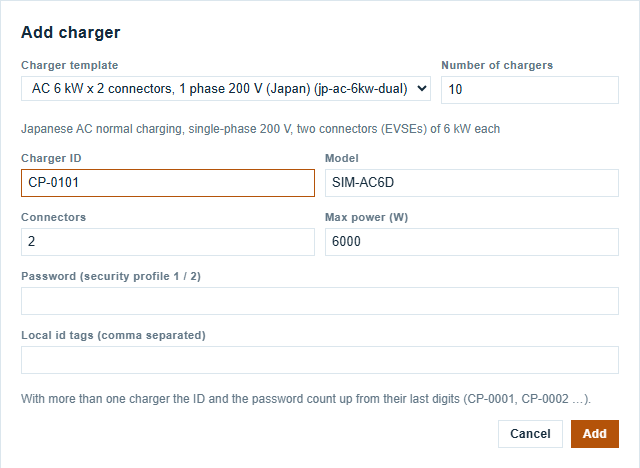

# Excel import / export and charger templates

Large sites are easier to maintain in a spreadsheet, and many chargers of the same model are easier to add from a
template. Both work from the web UI (**File** menu, **Add charger** dialog) and through the [HTTP API](http-api.md#excel-and-templates).

## Charger templates

A charger template is a set of model defaults: vendor / model, number of connectors, maximum power, supply voltage
and phases, and optionally ramps, `auth_mode`, `config_keys`, `session`, `maintenance` and similar fields. A charger
refers to a template with `template:`; every template field the charger does not set itself comes from the template:

```yaml
chargers:
  - id: "CP-0001"
    template: jp-ac-6kw          # 6 kW, single-phase 200 V
  - id: "CP-0002"
    template: jp-ac-6kw-dual
    max_power_w: 3000            # own value wins over the template
```

Connection and security settings (`id`, `csms_url`, `ocpp_version`, `password`, certificates) are never part of a
template, so every template fits OCPP 1.6 and 2.0.1 chargers.

Built-in templates (AC only; DC charging is not modelled):

| Name | Model | Connectors | Max power | Supply |
|---|---|---|---|---|
| `jp-ac-3kw` | `SIM-AC3` | 1 | 3 kW | 1 phase 200 V, 15 A (Japan) |
| `jp-ac-6kw` | `SIM-AC6` | 1 | 6 kW | 1 phase 200 V, 30 A (Japan) |
| `jp-ac-6kw-dual` | `SIM-AC6D` | 2 | 6 kW each | 1 phase 200 V (Japan) |
| `eu-ac-11kw` | `SIM-AC11` | 1 | 11 kW | 3 phase 230 / 400 V, 16 A |
| `eu-ac-22kw` | `SIM-AC22` | 1 | 22 kW | 3 phase 230 / 400 V, 32 A |

When the configuration is saved, a templated charger keeps only its own overrides (values equal to the template's
are left out). So a later change of the template applies to every charger that uses it.

The comparison is with the template's value: a value equal to the model default is still written when it differs
from the template (e.g. `phases: 1` on `eu-ac-11kw`, `connectors: 1` on `jp-ac-6kw-dual`). `config_keys`,
`session` and `maintenance` are compared key by key: a charger that sets one key keeps only that key, the
template's other keys still follow the template.

!!! warning "Deleting a user template that chargers use"
    If a user template file is deleted (and the templates reloaded) while chargers still refer to it, the running
    chargers keep their values, but the configuration can no longer be loaded: start, config reload and Excel
    import fail with `charger 'CP1': unknown template 'my-wallbox' (known: ...); restore the user template file,
    or remove 'template' from the charger and set its fields`. Restore the file, or remove `template:` (and
    `params:`) from those chargers.

### User templates

User templates are YAML files in `~/.sme-ocpp-sim/templates/` (or the directory in the environment variable
`SME_OCPP_SIM_TEMPLATES`). A user template with the name of a built-in one replaces it. **File → Device templates →
Save as device template** writes the selected charger's model fields as a new user template; **Reload user device
templates** reads the directory again. File format:

```yaml
name: my-wallbox            # default: the file name
title: My 7 kW wallbox
params: {kw: 7}             # defaults; a charger overrides them with params: {kw: 11}
model: "WB-{kw}"
max_power_w: "{kw}000"      # exactly one placeholder keeps the type: 7000
config_keys: {MeterValueSampleInterval: "60"}
```

Allowed keys: `name`, `title`, `description`, `params` and the template fields `vendor`, `model`, `firmware`,
`connectors`, `max_power_w`, `voltage_v`, `phases`, `line_to_line`, `ramp_up_w_per_s`, `ramp_down_w_per_s`,
`auth_mode`, `boot_retry_s`, `meter_sample_interval_s`, `require_subprotocol`, `config_keys`, `session`,
`maintenance`. A file with another key or with values that do not make a valid charger is skipped and reported.

### Adding many chargers



The **Add charger** dialog takes a template and a number of chargers. With more than one, the ID and the password
count up from their trailing digits: first ID `CP-0001`, count 3 → `CP-0001`, `CP-0002`, `CP-0003`; password
`pass01` → `pass01`, `pass02`, `pass03` (a password without trailing digits is the same for all). An ID without
trailing digits is a prefix (`CP-` → `CP-1`, `CP-2` …). If any of the new IDs exists already, nothing is added.

## Excel workbook

**File → Export Excel workbook** downloads the chargers as `.xlsx`; **Import Excel workbook** applies an edited one;
**Download blank Excel template** gives an empty workbook with the headers. Row 1 holds the column names, row 2
(starting with `#`) a short help; any row starting with `#` is ignored.

| Sheet | Rows | Columns |
|---|---|---|
| `chargers` | One per charger (required sheet) | `id` (required), `template`, `ocpp_version`, `csms_url`, `password`, `vendor`, `model`, `serial`, `firmware`, `connectors`, `max_power_w`, `voltage_v`, `phases`, `line_to_line`, `auth_mode`, `id_tags` (comma separated), `ev_model`, `initial_soc`, `target_soc` (the `session` fields), `extra` |
| `config_keys` | One per OCPP 1.6 configuration key | `charger`, `key`, `value` |
| `variables` | One per OCPP 2.0.1 `variables` entry | `charger`, `component`, `component_instance`, `evse`, `connector`, `variable`, `variable_instance`, `value`, `target`, `min_set`, `max_set`, `extra` (definition of a user-defined variable) |
| `ev_models` | One per `ev_models` entry | `id`, `capacity_kwh`, `max_ac_kw`, `max_current_a`, `phases`, `min_current_a`, `efficiency`, `weight`, `initial_soc_dist`, `initial_soc_min`, `initial_soc_max`, `initial_soc_mean`, `initial_soc_sd` (`initial_soc` flattened; a fixed number is `fixed` with only `initial_soc_mean`), `target_soc` (a fixed number), `extra` (`curve`, `max_dc_kw`, a `target_soc` distribution) |

`extra` holds every other field as a YAML flow mapping, e.g. `{verify_tls: false, ramp_up_w_per_s: 500}`.

Rules:

* An import replaces the chargers and EV models as a whole; a missing optional sheet means none. Every other block
  (`simulation`, `csms_defaults`, `mini_csms`, …) stays as it is. Only chargers whose settings changed reconnect.
* Blank cells are the field's default, or the template's value for a charger with a `template`. The export fills
  every column of a charger without a template and leaves the template's columns of a templated charger empty.
* Passwords are exported as `********`. Importing `********` keeps the charger's stored password; a new charger
  needs its real password.
* Text stays text: an ID `0123` or `1e5` stored as a text cell is read unchanged. A cell Excel stores as a number
  is converted (`778` → `"778"`), so type leading zeros as text.
* No formulas: exported texts are always text cells, also a text starting with `=`, `+`, `-` or `@` (it gets
  Excel's quote prefix and is read back unchanged). An upload is limited to 10 MB and 5000 charger rows
  (50000 rows on the other sheets).
* An import is all or nothing. Errors name the sheet, row and column, e.g.
  `chargers row 4, column 'ocpp_version': unknown OCPP version '3.0'` or
  `chargers row 6, column 'id': duplicate charger id 'CP-0001' (also row 3)`.
