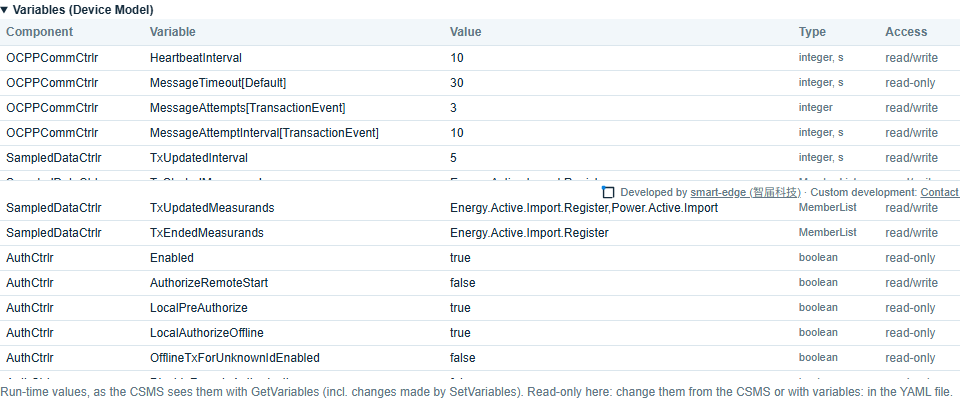

# Quick start

SME OCPPSim simulates the **charge point** side. You need a CSMS (central system) for the chargers to
connect to. The examples use [SteVe](https://github.com/steve-community/steve), an open-source OCPP 1.6 CSMS;
any OCPP 1.6J CSMS works. For OCPP 2.0.1 see [An OCPP 2.0.1 charger](#ocpp-201) below.

## Windows executable

Download `sme-ocpp-sim-vX.Y.Z-windows.exe` from the
[latest release](https://github.com/smartedge-tech-dev/sme-ocpp-sim/releases/latest) and run it. Without
`-c` it uses the per-user file `%USERPROFILE%\.sme-ocpp-sim\config.yaml`, created from the bundled demo
configuration (`configs/demo-site.yaml`) on the first run, and opens the web UI at <http://127.0.0.1:8082/>.
Saving from the web UI writes back to that file, so changes are kept across restarts; delete it to start
again from the demo configuration. With `-c FILE` that file is used and saved in place. The console log shows
the config file in use at startup (`config file: ...`).

```powershell
.\sme-ocpp-sim-v0.2.1-windows.exe -c my-site.yaml
```

## pip

Python 3.11 or later:

```powershell
python -m venv .venv
.venv\Scripts\pip install sme-ocpp-sim
.venv\Scripts\sme-ocpp-sim -c my-site.yaml
```

`pipx install sme-ocpp-sim` works as well.

## Docker

Images for linux/amd64 and linux/arm64 are published on GHCR. The container exposes only the web UI port
(8082): the simulated chargers are WebSocket *clients* that connect out to the CSMS, so no protocol port is
needed.

```bash
docker run --rm -p 8082:8082 ghcr.io/smartedge-tech-dev/sme-ocpp-sim
```

Inside the container `localhost` is the container itself, so the demo URL `ws://localhost:8180/...` does not
reach a CSMS on your machine. To reach a CSMS running on the Docker host, use `host.docker.internal` in the
CSMS URL, e.g. `ws://host.docker.internal:8180/steve/websocket/CentralSystemService`. Docker Desktop
(Windows / macOS) provides that name; on Linux add it with `--add-host=host.docker.internal:host-gateway`:

```bash
docker run --rm -p 8082:8082 --add-host=host.docker.internal:host-gateway \
  -v "$PWD/site.yaml:/app/configs/site.yaml" \
  ghcr.io/smartedge-tech-dev/sme-ocpp-sim \
  sme-ocpp-sim run -c configs/site.yaml --host 0.0.0.0 --no-browser
```

Set the time zone with `-e TZ=Asia/Tokyo` (default UTC). Offline image archives for `docker load -i` are
attached to every release.

## Command line options

| Option | Meaning |
|---|---|
| `-c, --config FILE` | YAML configuration (default: the bundled `configs/demo-site.yaml`; Windows executable: `~/.sme-ocpp-sim/config.yaml`, see above) |
| `--host 127.0.0.1` | Web UI bind address (default localhost only; `0.0.0.0` exposes it on the LAN) |
| `--http-port 8082` | Web UI port |
| `--no-browser` | Do not open the browser on start |
| `-v, --verbose` | Debug logging |
| `--version` | Show the version |

## First connection to SteVe

1. Start SteVe. The demo configuration expects it at `ws://localhost:8180/steve/websocket/CentralSystemService`.
2. In SteVe, register the charge box IDs `CP-0001`, `CP-0002` and `CP-0003`. SteVe refuses an unregistered
   charge box ID at the WebSocket handshake with HTTP 404; the UI shows this as a handshake error.
3. Register the OCPP tags `04A1B2C3` and `TAG-0002` if Authorize should return Accepted.
4. Start SME OCPPSim. Each charger connects, sends BootNotification and StatusNotification, then heartbeats.
5. In the web UI, plug a connector, swipe a tag and start a transaction. MeterValues appear in the frame log
   and the transaction in SteVe.
6. From SteVe, send SetChargingProfile to a charging connector and watch the power follow the limit in the
   Smart Charging panel.

To use another CSMS, change `csms_defaults.url` in the YAML file or in the settings dialog of the UI. The
charger id is appended to the URL as the last path segment.

## An OCPP 2.0.1 charger { #ocpp-201 }

A 2.0.1 charging station needs a CSMS that speaks OCPP 2.0.1 (subprotocol `ocpp2.0.1`). `ocpp_version` is set
per charger (or for all of them in `csms_defaults`), so 1.6 and 2.0.1 chargers can run side by side, each with
its own `csms_url`:

```yaml
csms_defaults:
  url: "ws://localhost:8180/steve/websocket/CentralSystemService"   # OCPP 1.6 CSMS
  ocpp_version: "1.6"

chargers:
  - id: "CP-0001"                     # OCPP 1.6J
    max_power_w: 6000
    id_tags: ["04A1B2C3"]
  - id: "CS-2001"                     # OCPP 2.0.1, two EVSEs
    ocpp_version: "2.0.1"
    csms_url: "ws://localhost:9000/ocpp"
    connectors: 2
    max_power_w: 7400
    id_tags: ["04A1B2C3"]
    variables:
      - { component: OCPPCommCtrlr, variable: HeartbeatInterval, value: 120 }
```

[`configs/mixed-site.yaml`](https://github.com/smartedge-tech-dev/sme-ocpp-sim/blob/main/configs/mixed-site.yaml) is a complete example. Replace the 2.0.1 URL with the charging-station
endpoint of your CSMS; the station id is appended as the last path segment, as for 1.6. The version can also be
changed in the settings dialog of the UI (the charger reconnects).

For a 2.0.1 charger the web UI shows:

- the OCPP version in the charger list and in the detail header;
- EVSEs instead of connectors (`connectors: N` = N EVSEs with one connector each);
- **Variables (Device Model)** instead of configuration keys: the run-time values as the CSMS reads them with
  GetVariables, incl. its SetVariables changes. The table is read-only (the HTTP API has no route to change a
  variable): change values from the CSMS, or with `variables:` in the YAML file;
- an **External limit (EMS)** control in the Smart Charging panel, see [Smart Charging](smart-charging.md#ocpp-201).

The fault dialog lists the fault codes of the charger's version. A 2.0.1 StatusNotification has no error code,
so a 2.0.1 fault reports the EVSE as Faulted and the code is sent only as the `stoppedReason` of a transaction it
interrupts.


