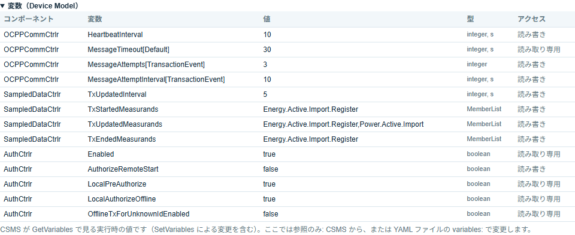

# 設定

シミュレーターは 1 つの YAML ファイル（`-c FILE`）を読み込みます。どのブロックも省略可能で、未知のフィールドは
エラーになります。完全な例は [`configs/demo-site.yaml`](https://github.com/smartedge-tech-dev/sme-ocpp-sim/blob/main/configs/demo-site.yaml) です。

```yaml
simulation:
  tick_seconds: 1
  time_scale: 1
  running: true

frame_log:
  size: 20000

csms_defaults:
  url: "ws://localhost:8180/steve/websocket/CentralSystemService"
  ocpp_version: "1.6"
  security_profile: 0
  reconnect: { min_s: 1, max_s: 60, jitter: 0.2 }

ev_models:
  - id: "demo-60kwh"
    capacity_kwh: 60
    max_ac_kw: 11
    max_current_a: 16
    phases: 3

chargers:
  - id: "CP-0001"
    max_power_w: 6000
    id_tags: ["04A1B2C3", "TAG-0002"]
    config_keys:
      HeartbeatInterval: 300
```

!!! warning "ID・タグ・パスワードは引用符で囲んでください"
    YAML 1.1 では、引用符なしの `0123`、`1e5`、`ON`、`OFF`、`yes`、`no` は文字列になりません。識別子やテキストの
    フィールド（`id`、`id_tags`、`password`、URL、`vendor` など）は引用符付きの文字列だけを受け付け、`0123` が
    黙って `83` になる代わりに、引用符を付けるよう案内します。

## Web UI からの保存 { #saving-from-the-web-ui }

UI での変更はすぐに反映され（再接続するのは変更した充電器だけです）、YAML ファイルへ保存できます。保存時は、
変更のあったトップレベルブロック（`simulation`、`frame_log`、`csms_defaults`、`ev_models`、`chargers`）を丸ごと置き換えます。

- 変更したブロックの **外** にあるコメントは保持されます。改行コードと UTF-8 BOM も保持されます。
- 変更したブロックの **中** にあるコメントは失われます。どれか 1 台の充電器を変更すると `chargers:` ブロック全体が
  書き直されるため、**個々の充電器エントリの中にはコメントを書かないでください**。コメントは `chargers:` キーの上に書いてください。
- 既定値と同じ値は書き出されません。
- ブロックを差し替えられない場合（特殊なレイアウト）はドキュメント全体を書き直し、すべてのコメントが失われます。その際は警告をログに出力します。

パスワードは HTTP API では返さず、`********` と表示します。マスクのまま設定を送り返すと、保存済みのパスワードが維持されます。

## simulation

| フィールド | 既定値 | 意味 |
|---|---|---|
| `tick_seconds` | `1.0` | 電力モデルの刻み（秒、> 0） |
| `time_scale` | `1.0` | 電力モデル（ランプ、電力量レジスタ、SoC）だけを加速します。充電スケジュールと OCPP のタイミングは常に実時間です |
| `running` | `true` | `false` で電力モデルを停止します。OCPP セッションは動作し続けます |

## frame_log

| フィールド | 既定値 | 意味 |
|---|---|---|
| `size` | `20000` | メモリに保持する OCPP フレーム数（全充電器の合計、≥ 100） |

## csms_defaults

| フィールド | 既定値 | 意味 |
|---|---|---|
| `url` | なし | CSMS の WebSocket URL（`ws://` または `wss://`）。充電器 ID を最後のパスセグメントとして付加します。すべての充電器に `csms_url` がある場合を除き必須です |
| `ocpp_version` | `"1.6"` | `"1.6"` または `"2.0.1"`。`"2.1"` は v0.3 で対応予定としてエラーになります |
| `security_profile` | `0` | `0`、`1`、`2`、`3`。各充電器の設定をこれに照らして検査します。[セキュリティプロファイル](security-profiles.md) を参照 |
| `reconnect.min_s` | `1.0` | 最初の再接続待ち時間（秒） |
| `reconnect.max_s` | `60.0` | 再接続待ち時間の上限（≥ `min_s`）。待ち時間は指数的に増えます |
| `reconnect.jitter` | `0.2` | 待ち時間のランダムなばらつき（0〜1） |
| `reconnect.max_retries` | `null` | 連続した接続失敗（ハンドシェイク失敗、または Boot が Accepted になる前に切れた接続）の上限。超えると充電器は再試行を止め、UI に **再試行停止** と表示され、接続 を押すまで再開しません。`null` = 無制限、`0` = 最初の失敗で停止 |

## ev_models

`session.ev_model` から参照するカスタム EV モデルです。同じ ID の組み込みプリセットより優先されます。
組み込みプリセットは[車両プール](#vehicle-pool)にあります。

| フィールド | 既定値 | 意味 |
|---|---|---|
| `id` | 必須 | 一意な ID（引用符付き文字列） |
| `capacity_kwh` | 必須 | 電池容量 |
| `max_ac_kw` | 必須 | AC 充電の最大電力 |
| `max_current_a` | `32.0` | 1 相あたりの最大電流 |
| `max_dc_kw` | なし | 将来の互換性のために受け付けます。v0.1 では DC 充電をモデル化していません |
| `phases` | `1` | 車載充電器が使う相数（1、2、3） |
| `min_current_a` | `6.0` | 1 相あたりこの電流を下回ると EV は充電できません（≤ `max_current_a`） |
| `efficiency` | `0.9` | 電池に届くエネルギーの割合（0〜1] |
| `curve` | 組み込み | `[SoC %, 最大値に対する割合]` の組のリスト（充電のテーパー） |
| `weight` | `1` | 車両プールでの重み（`session.ev_model: pool`）。`0` = 選ばれません |
| `initial_soc` | 充電器の `session.initial_soc` | プールから選ばれたときの初期 SoC。数値（固定）または分布（下記） |
| `target_soc` | 充電器の `session.target_soc` | プールから選ばれたときの目標 SoC。数値または分布 |

### 車両プール {#vehicle-pool}

`session.ev_model: pool` にすると、新しいトランザクションごとに車両プールから EV を 1 台選びます。プールは
組み込みプリセットと `ev_models` の各エントリー（プリセットと同じ ID のエントリーはそのプリセットを置き換えます）で、
`weight` に従って選ばれます。初期 SoC と目標 SoC は選ばれたエントリーから決まります。SoC の分布はマッピングです:

| キー | 既定値 | 意味 |
|---|---|---|
| `dist` | `uniform` | `fixed`（`mean`）、`[min, max]` 上の `uniform`、または `[min, max]` で切り詰めた `normal`（`mean`、`sd`）。`dist` を省略して `mean` / `sd` を書くとエラーです（推測しません） |
| `min` / `max` | `0` / `100` | 範囲（%） |
| `mean` | なし | 固定値または正規分布の平均（`[min, max]` 内。`uniform` では指定不可） |
| `sd` | なし | `normal` の標準偏差（≥ 0） |

```yaml
ev_models:
  - id: my-van
    capacity_kwh: 75
    max_ac_kw: 11
    phases: 3
    weight: 2
    initial_soc: {dist: normal, mean: 35, sd: 10, min: 5, max: 80}
    target_soc: 90
chargers:
  - id: CP001
    session: {ev_model: pool}
```

選択は決定的です。コネクターごとに独立した乱数ストリーム `vehicle:{charger}:{connector}` を使うため、
充電器を追加しても他の充電器の並びは変わりません。シードの設定はまだありません（後のリリースのトラフィック
ジェネレーターで追加します）。シードは 0 に固定のため、どのコネクターも毎回同じ並びで選びます。ストリームは
充電器の起動時に始まり、再起動や、充電器を作り直す設定変更（`ev_models` の編集など）では最初から再生されます。
1 回の選択は必ず 3 個の乱数（車両・初期 SoC・目標 SoC）を使うため、エントリーの分布を変えてもそのエントリー
から選ばれる値が変わるだけで、以降の選択は変わりません。重みやエントリーの一覧を変えると、選ばれる車両が
変わります。値は 0.01 % 単位に丸めます。

エントリーの初期 SoC が目標 SoC を超えうる場合（両方を指定したとき。分布ではその `max` と目標の `min` を比較）、
YAML ファイルの読み込み時に警告をログに出します。そのセッションは目標より上から始まり、電力を受け付けません
（SuspendedEV）。

プリセット（実在の車種ではなく抽象的な車両クラス。プールでの重み・初期 SoC。目標 SoC は充電器の
`session.target_soc`）:

| プリセット | 電池・AC | 重み | 初期 SoC |
|---|---|---|---|
| `kei-20kwh` | 20 kWh、3 kW、15 A、単相 | 2 | uniform 10〜60 % |
| `compact-40kwh` | 40 kWh、6 kW、30 A、単相 | 3 | uniform 10〜60 % |
| `midsize-60kwh` | 60 kWh、11 kW、16 A、三相 | 2 | uniform 10〜60 % |
| `suv-90kwh` | 90 kWh、11 kW、16 A、三相 | 1 | normal 40 ± 15、10〜80 % |
| `phev-12kwh` | 12 kWh、3.2 kW、16 A、単相 | 1 | uniform 0〜40 % |
| `van-75kwh` | 75 kWh、11 kW、16 A、三相、効率 0.88 | 1 | normal 30 ± 10、5〜70 % |

## chargers

| フィールド | 既定値 | 意味 |
|---|---|---|
| `id` | 必須 | Charge Point ID（引用符付き文字列）。URL の最後のパスセグメントと Basic 認証のユーザー ID に使うため、`:` は使えません。`bulk` は予約済みです |
| `csms_url` | `csms_defaults.url` | 充電器ごとの CSMS URL |
| `ocpp_version` | `csms_defaults.ocpp_version` | 充電器ごとの OCPP バージョン（`"1.6"` または `"2.0.1"`）。1 つのサイトで混在できます |
| `password` | なし | Basic 認証のパスワード（セキュリティプロファイル 1 / 2） |
| `ca_file` | システムの信頼ストア | `wss://` で CSMS の証明書を検証する追加の CA バンドル（PEM） |
| `client_cert_file` | なし | セキュリティプロファイル 3：充電器の TLS クライアント証明書（PEM、チェーン可） |
| `client_key_file` | なし | セキュリティプロファイル 3：その秘密鍵（PEM、暗号化なし） |
| `verify_tls` | `true` | `false` で証明書の検証を省略します（試験専用。警告をログに出力します） |
| `require_subprotocol` | `true` | `false` にすると、CSMS が `ocpp1.6` / `ocpp2.0.1` サブプロトコルを返さなくても接続を続けます |
| `vendor` | `"SmartEdge"` | BootNotification の `chargePointVendor`（最大 20 文字） |
| `model` | `"SIM-AC6"` | `chargePointModel`（最大 20 文字） |
| `serial` | なし | `chargePointSerialNumber`（最大 25 文字） |
| `firmware` | `"0.1.0"` | `firmwareVersion`（最大 50 文字） |
| `connectors` | `1` | コネクター数（1〜32）。すべてのコネクターが以下の電源設定と `max_power_w` を共有します。OCPP 2.0.1 では EVSE の数（各 1 コネクター） |
| `config_keys` | `{}` | OCPP 1.6: 設定キーの初期値（例: `HeartbeatInterval: 300`）。数値と真偽値は引用符なしで書けます。2.0.1 の充電器では使いません（`variables` を参照）。`AuthorizationKey` はここでは設定できません（`password` を使います）。Security Whitepaper のキー `SecurityProfile`（読取専用、使用中のプロファイル）、`CpoName`（既定は `vendor`）、`CertificateStoreMaxLength`、`AdditionalRootCertificateCheck`（`false`）もあります |
| `auth_mode` | `local_then_csms` | `local_only`（`id_tags` のみ）、`csms_only`（常に Authorize）、`local_then_csms`（まず `id_tags`、次に Authorize）、`accept_all` |
| `id_tags` | `[]` | ローカルで受け付ける ID タグ（各最大 20 文字、重複不可） |
| `boot_retry_s` | `60.0` | CSMS が interval 0 で Pending / Rejected を返したときの Boot 再送間隔 |
| `boot_max_retries` | `null` | Accepted 以外の BootNotification 応答（Pending・Rejected・無応答。Accepted まで再接続をまたいで数える）の上限。超えると接続を閉じ、`reconnect.max_retries` と同様に停止します。`null` = 無制限（OCPP どおり）。TriggerMessage による BootNotification は数えません。Pending を返しては接続を切る CSMS では、両方の上限に数えられます（Boot ごと・切断ごと） |
| `max_power_w` | `6000.0` | 各コネクターのハードウェア上の最大電力 |
| `voltage_v` | `200.0` | 電源の公称電圧 |
| `phases` | `1` | 電源の相数（1、2、3） |
| `line_to_line` | `false` | `true` のとき、三相電源の `voltage_v` を線間電圧とみなします（日本の三相 200 V デルタなど）。相電圧 = `voltage_v / √3` |
| `ramp_up_w_per_s` | なし | 模擬時間 1 秒あたりの電力の上昇幅（W）。なし = ステップ変化 |
| `ramp_down_w_per_s` | なし | 電力の下降幅。なし = ステップ変化（制限値を下げると 1 tick 以内に反映） |
| `session.ev_model` | `compact-40kwh` | コネクターに接続する EV（プリセットまたは `ev_models` の ID）、または `pool`（トランザクションごとに[車両プール](#vehicle-pool)から選びます） |
| `session.initial_soc` | `30.0` | 各トランザクション開始時の SoC（%）。`pool` では `initial_soc` のない `ev_models` エントリーの既定値 |
| `session.target_soc` | `90.0` | この SoC に達すると EV は電力を受け付けなくなります（SuspendedEV） |
| `meter.begin_end_messages` | `false` | OCPP 1.6：受け付けられた StartTransaction の後に context `Transaction.Begin`、StopTransaction の直前に `Transaction.End` の MeterValues も送ります（測定項目は `MeterValuesSampledData`）。OCPP 2.0.1 では常に `Started` / `Ended` イベントに含まれます |
| `meter.phase_values` | `off` | `off`：phase なしの `Voltage` と均等な `Current.Import` を 1 つずつ。`L-N`：電源の相ごとに `Voltage`（`L1-N`、`L2-N`、`L3-N`）。`L-L`：三相電源では線間電圧（`L1-L2`、`L2-L3`、`L3-L1`、相電圧の √3 倍）、1 相・2 相では `L-N` と同じ。どちらでも `Current.Import` は電源の相ごと（`L1`..、EV が使わない相は 0 A）。`voltage_v` / `phases` / `line_to_line` を使います |
| `meter.post_tx_delay_s` | `0` | トランザクション終了から StopTransaction（1.6）/ `Ended` の TransactionEvent（2.0.1）を送るまでの秒数。送信キューは順序を保つため、後に積まれたメッセージはすべて待ちます：Finishing の StatusNotification、遅延中に始めた新しいトランザクションの StartTransaction / `Started` も含みます。Reset はキューが空になるのを最大で呼び出しタイムアウトまでしか待たないため、それより長い遅延では Reset で終了したトランザクションの StopTransaction / `Ended` は再起動前に送られず、キューに残って次に受け付けられた BootNotification の後に送られます |
| `meter.tx_data_max_samples` | `1000` | StopTransaction の `transactionData` / `Ended` の `meterValue` 用に 1 トランザクションで保持するサンプル値・時刻同期値それぞれの上限（1–10000）。古いものから捨て、トランザクションごとに 1 回警告をログに出します。開始・終了の読み値は数えません。読み値は電力モデルの tick（`simulation.tick_seconds`）で取るため、分解能は tick に制限されます（tick・ストリームごとに最大 1 つ、区間の境界時刻を付けます） |
| `impairments.block` | `{}` | コマンド遮断（シミュレーター独自）：CSMS → 充電器のアクション名 → `NotImplemented` / `NotSupported`（その CALLERROR を返す）または `NoReply`（応答せず、CSMS 側がタイムアウト）。充電器の OCPP バージョンが受信するアクション名に限ります。再接続なしで動作中の充電器に反映されます。[HTTP API](http-api.md#command-blocking-and-frame-injection) 参照 |
| `impairments.latency_ms` / `jitter_ms` | `0` / `0` | 通信遅延（シミュレーター独自）：`impairments.direction`（`both` / `tx` = 送信 / `rx` = 受信）の各フレームを `latency_ms` ± `jitter_ms`（一様分布。`jitter_ms` ≤ `latency_ms`）だけ遅らせます。フレームの順序は保たれます（短い遅延は前の長い遅延の後ろで待ちます）。遅延は `impairments.seed`（`null` = 充電器 ID の CRC32）を種とする乱数で決まるため再現できます。乱数は接続ごとに最初からやり直し、`seed` の変更は次の接続から反映されます。遅延を下げる・なくすと保留中のフレームはすぐに流れます。接続が切れた時点でまだ保留中の送信フレームは、実際のネットワークと同様に失われます。WebSocket の ping / pong は遅延しません |
| `impairments.drop_every_s` / `drop_jitter_s` | `null` / `0` | 周期切断：接続のたびに、接続から `drop_every_s` ± `drop_jitter_s` 秒後に切断します（`null` = なし。`drop_jitter_s` < `drop_every_s`）。`drop_every_s`・`drop_jitter_s`・`seed` を変更すると進行中の間隔は最初から数え直します（他の項目の変更では数え直しません） |
| `impairments.drop_mode` / `down_s` | `abort` / `5` | 模擬切断の方法：`abort` は close フレームを送らず TCP 接続を切ります（ケーブル抜け）、`close` はコード 1001 で閉じます。`down_s`：再接続までの待ち時間（`POST /api/chargers/{id}/drop` の既定値も兼ねる）。模擬切断は接続失敗**ではありません**：`reconnect.max_retries` / `boot_max_retries` に数えず、バックオフも使いません。トランザクションと送信待ちメッセージは保持され、次の接続で送られます（`last_error` の kind は `simulated_drop`）。`impairments` の全項目は再接続なしで反映されます |
| `impairments.remote_start` | `normal` | `accept_no_tx`：RemoteStartTransaction（1.6）/ RequestStartTransaction（2.0.1）に `Accepted` と答えるが何も開始しない（StartTransaction / TransactionEvent `Started` を送らず、コネクター状態も変えない）。CSMS からは受理されたのに始まらない開始に見える |
| `impairments.meter.drop_ratio` | `0` | 周期メーター値（1.6 MeterValues `Sample.Periodic`、2.0.1 TransactionEvent `Updated` / `MeterValuePeriodic`）を送らない割合（0〜1）。2.0.1 で落とした event も `seqNo` を消費する（CSMS には欠番が見える） |
| `impairments.meter.reorder_window` | `0` | 周期メーター値をこの件数ためてからランダムな順序で送る（タイムスタンプと `seqNo` は元の値のまま）。`0` / `1` = オフ。ためた分はトランザクション終了メッセージの前に送る |
| `impairments.meter.end_after_stop` | `false` | 最後のメーター値を StopTransaction / Ended event の後に送る（SAP `outOfOrderEndMeterValues`）。1.6 は `Transaction.End` の MeterValues（`meter.begin_end_messages`）か停止時点の `Sample.Periodic` を StopTransaction の後に、2.0.1 は `Updated` event（`seqNo` は Ended の次）を送る |
| `impairments.meter.voltage_noise_v` | `0` | 報告する Voltage すべてに一様分布 ± のノイズ（V）を加える |
| `impairments.response_delay_ms` | `{}` | CSMS → 充電器のアクション名 → ms：その CALL への応答（CALLRESULT / CALLERROR）だけをその時間保留する（他のフレームは遅らせない）。CSMS のタイムアウトより長ければ「遅い充電器」。未知のアクションは `block` と同じく `400` |
| `template` | なし | 充電器テンプレート（組み込みまたはユーザー。[Excel とテンプレート](excel-templates.md) 参照）。この充電器が設定していないテンプレート項目はテンプレートの値 |
| `params` | `{}` | `{param}` プレースホルダを持つユーザーテンプレートのパラメータ |
| `meter_sample_interval_s` | キーの既定値 | `config_keys` で指定していない場合の `MeterValueSampleInterval` の既定値。2.0.1 では `SampledDataCtrlr.TxUpdatedInterval` の初期値 |
| `variables` | `[]` | OCPP 2.0.1 の充電器のみ: Device Model の値の上書きとユーザー定義変数（下記） |

### variables（OCPP 2.0.1） { #variables }

2.0.1 の充電器は `config_keys` の代わりに Device Model を持ちます。シミュレーターが動作に使う最小限の標準変数を
備えています。例: `OCPPCommCtrlr.HeartbeatInterval`、`SampledDataCtrlr.TxUpdatedInterval`（初期値は
`meter_sample_interval_s`、未指定なら 60）と `TxUpdatedMeasurands`、`AuthCtrlr.AuthorizeRemoteStart`、
`TxCtrlr.StopTxOnInvalidId`、`OCPPCommCtrlr.MessageAttempts[TransactionEvent]`、
`DeviceDataCtrlr.ItemsPerMessage[GetReport|GetVariables|SetVariables]`、認証制御の
`AuthCtrlr.Enabled` / `LocalPreAuthorize` / `LocalAuthorizeOffline` / `OfflineTxForUnknownIdEnabled` /
`DisableRemoteAuthorization`（ReadWrite。初期値は `auth_mode` から決まり、SetVariables による変更は即時に反映）、
`SmartChargingCtrlr.Enabled`（ReadWrite、動作には反映しない）と `NotifyChargingLimitWithSchedules`（既定値
`false`）、`SecurityCtrlr.SecurityProfile` / `Identity` / `BasicAuthPassword`（新しいパスワードは受け付けられ、
充電器はそのパスワードで再接続する。メモリ上のみ）、必須の ChargingStation / EVSE / Connector の変数
（`Available`、`AvailabilityState`、EVSE の `Power` と `SupplyPhases`）。OCPP 2.0.1 が必須とするその他の変数
（例: `OCPPCommCtrlr.OfflineThreshold`、`TxCtrlr.EVConnectionTimeOut`、
`SmartChargingCtrlr.Entries[ChargingProfiles]`）は、シミュレーターの動作を表す値で読み取り専用として報告されます。CSMS は GetVariables / SetVariables で読み書きし、GetBaseReport で一覧を取得します。
`GET /api/chargers/{id}/configuration` では `variables` に表示されます。SetVariables による変更は YAML
ファイルには書き戻されません。

`variables` の各エントリは 1 つの変数を指します: `component`、任意の `component_instance`・`evse`・`connector`、
`variable`、任意の `variable_instance`。

- 標準変数を指すエントリは、その `value`（`Actual` 属性）を設定します。他の設定から導出される変数
  （`auth_mode`、充電器 ID、CSMS URL、EVSE の状態、トランザクションの開始 / 終了点）は設定できません。
- それ以外のエントリはユーザー定義変数で、`data_type`（`string`、`decimal`、`integer`、`dateTime`、`boolean`、
  `OptionList`、`SequenceList`、`MemberList`）と `value` が必要です。任意: `mutability`（既定 `ReadWrite`、
  `ReadOnly`、`WriteOnly`）、`unit`、`min_limit` / `max_limit`（数値の範囲。`string` では長さ）、`values_list`
  （リスト型では必須）、`target` / `min_set` / `max_set`（追加の属性）、`reboot_required`（SetVariables が
  `RebootRequired` を返す）、`persistent`、`constant`、`summary`（SummaryInventory レポートに含める）。

```yaml
chargers:
  - id: "CP201"
    ocpp_version: "2.0.1"
    variables:
      - component: OCPPCommCtrlr
        variable: HeartbeatInterval
        value: 120
      - component: DeviceDataCtrlr
        variable: ItemsPerMessage
        variable_instance: GetReport
        value: 10
      - component: VendorCtrlr
        variable: ChargeMode
        data_type: OptionList
        values_list: [Eco, Fast]
        value: Eco
```

値は設定の読み込み時に検証されます（型、範囲、`values_list`）。1.6 の充電器に `variables` を書くとエラーです。

Web UI では、2.0.1 の充電器の **変数（Device Model）** 表にこれらの値を参照のみで表示します。



1.6 / 2.0.1 混在の例は [`configs/mixed-site.yaml`](https://github.com/smartedge-tech-dev/sme-ocpp-sim/blob/main/configs/mixed-site.yaml) です。

未対応: 2.0.1 の `evses` ツリー（EVSE あたり複数コネクター）、`behaviors`。充電器テンプレートは [Excel とテンプレート](excel-templates.md) を参照。


## mini_csms { #mini_csms }

組み込みの簡易 CSMS です。[Mini CSMS](mini-csms.md) を参照。既定では無効です。

| 項目 | 既定値 | 意味 |
|---|---|---|
| `enabled` | `false` | Mini CSMS の WebSocket サーバーを起動する |
| `host` | `"127.0.0.1"` | 待受アドレス（他ホストや Docker からは `"0.0.0.0"`） |
| `port` | `9000` | 待受ポート |
| `versions` | `["1.6", "2.0.1"]` | 受け付ける OCPP バージョン（サブプロトコル交渉） |
| `boot.status` | `Accepted` | BootNotification の応答: `Accepted`、`Pending`、`Rejected` |
| `boot.interval` | `300` | Heartbeat 間隔（Accepted）または再試行待ち（Pending / Rejected）、秒 |
| `auth.basic` | `false` | `true` = Security Profile 1: HTTP Basic 認証を必須にする |
| `auth.credentials` | `[]` | ステーションごとの `{id, password}`。`basic: true` ではそれ以外の ID・パスワードを拒否（HTTP 401）。Web UI ではマスク表示 |
| `authorize.default` | `Accepted` | ID タグ / ID トークンに返す認可状態 |
| `authorize.tags` | `{}` | タグごとの上書き（例 `{"BAD": "Blocked"}`。2.0.1 専用の状態は 1.6 には `Invalid` で返す） |
| `strict` | `false` | スキーマに合わないペイロードに CALLERROR を返す（既定: 応答して警告を記録） |
| `call_timeout_s` | `30` | ステーションへ送る CALL のタイムアウト |
| `frame_log_size` | `5000` | Mini CSMS 専用フレームログの保持数 |
| `plan` | `[]` | 予定 CALL: `at_s`、`after`（`boot` / `connect`）、`action`、`payload`、任意で `charger`（パターン）と `ocpp_version` |

`enabled`、`host`、`port` を変えると Mini CSMS は再起動します（ステーションは再接続）。その他の変更は即時反映されます
（計画の変更は次の接続から）。ポートを確保できない場合はイベントログとパネルに表示されます。
