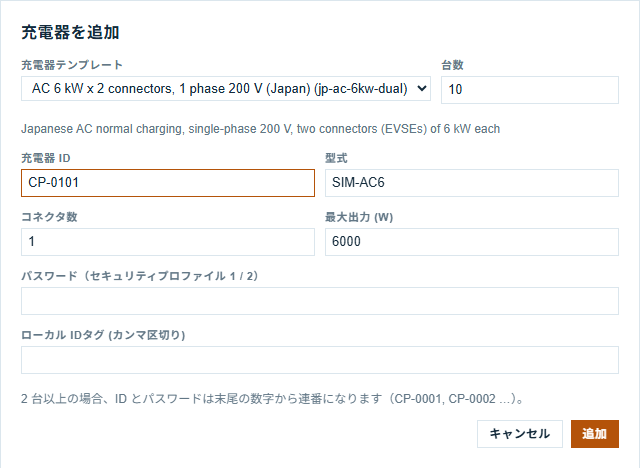

# Excel インポート / エクスポートと充電器テンプレート

台数の多いサイトは表計算ソフトで管理する方が簡単で、同じ型式の充電器はテンプレートから追加する方が簡単です。どちらも
Web UI（**ファイル** メニュー、**充電器を追加** ダイアログ）と [HTTP API](http-api.md#excel-and-templates) から使えます。

## 充電器テンプレート

充電器テンプレートは型式の既定値の集まりです：ベンダー / 型式、コネクタ数、最大電力、電源電圧と相数、必要に応じて
ランプ、`auth_mode`、`config_keys`、`session`、`maintenance` など。充電器は `template:` でテンプレートを参照し、
充電器自身が設定していないテンプレート項目はテンプレートの値になります：

```yaml
chargers:
  - id: "CP-0001"
    template: jp-ac-6kw          # 6 kW、単相 200 V
  - id: "CP-0002"
    template: jp-ac-6kw-dual
    max_power_w: 3000            # 充電器自身の値が優先
```

接続・セキュリティ設定（`id`、`csms_url`、`ocpp_version`、`password`、証明書）はテンプレートに含まれないため、
どのテンプレートも OCPP 1.6 / 2.0.1 の両方の充電器に使えます。

組み込みテンプレート（AC のみ。DC 充電はモデル化していません）：

| 名前 | 型式 | コネクタ | 最大電力 | 電源 |
|---|---|---|---|---|
| `jp-ac-3kw` | `SIM-AC3` | 1 | 3 kW | 単相 200 V・15 A（日本） |
| `jp-ac-6kw` | `SIM-AC6` | 1 | 6 kW | 単相 200 V・30 A（日本） |
| `jp-ac-6kw-dual` | `SIM-AC6D` | 2 | 各 6 kW | 単相 200 V（日本） |
| `eu-ac-11kw` | `SIM-AC11` | 1 | 11 kW | 三相 230 / 400 V・16 A |
| `eu-ac-22kw` | `SIM-AC22` | 1 | 22 kW | 三相 230 / 400 V・32 A |

設定を保存すると、テンプレートを使う充電器には自身の上書き値だけが残ります（テンプレートと同じ値は書き出されません）。
そのため、後からテンプレートを変えると、それを使うすべての充電器に反映されます。

比較の相手はテンプレートの値です。モデルの既定値と同じ値でも、テンプレートと異なれば書き出されます（例: `eu-ac-11kw`
の `phases: 1`、`jp-ac-6kw-dual` の `connectors: 1`）。`config_keys` / `session` / `maintenance` はキー単位で比較し、
充電器が設定したキーだけが残ります（テンプレートのほかのキーは引き続きテンプレートに従います）。

!!! warning "充電器が使っているユーザーテンプレートの削除"
    充電器が参照しているユーザーテンプレートのファイルを削除（してテンプレートを再読み込み）すると、動作中の充電器は
    値を保ちますが、設定を読み込めなくなります。起動・設定の再読み込み・Excel 取り込みは
    `charger 'CP1': unknown template 'my-wallbox' (known: ...); restore the user template file, or remove
    'template' from the charger and set its fields` で失敗します。ファイルを戻すか、該当する充電器から `template:`
    （と `params:`）を外してください。

### ユーザーテンプレート

ユーザーテンプレートは `~/.sme-ocpp-sim/templates/`（または環境変数 `SME_OCPP_SIM_TEMPLATES` のディレクトリ）に置く
YAML ファイルです。組み込みと同じ名前のユーザーテンプレートは組み込みを置き換えます。**ファイル → デバイステンプレート →
デバイステンプレートとして保存** で選択中の充電器の型式項目を新しいユーザーテンプレートとして書き出し、
**ユーザーデバイステンプレートを再読込** でディレクトリを読み直します。ファイル形式：

```yaml
name: my-wallbox            # 既定：ファイル名
title: My 7 kW wallbox
params: {kw: 7}             # 既定値。充電器側で params: {kw: 11} のように上書き
model: "WB-{kw}"
max_power_w: "{kw}000"      # プレースホルダ 1 個だけなら型を保持：7000
config_keys: {MeterValueSampleInterval: "60"}
```

使えるキー：`name`、`title`、`description`、`params` とテンプレート項目 `vendor`、`model`、`firmware`、`connectors`、
`max_power_w`、`voltage_v`、`phases`、`line_to_line`、`ramp_up_w_per_s`、`ramp_down_w_per_s`、`auth_mode`、
`boot_retry_s`、`meter_sample_interval_s`、`require_subprotocol`、`config_keys`、`session`、`maintenance`。
それ以外のキーを含むファイルや、有効な充電器にならない値のファイルは読み飛ばされ、報告されます。

### まとめて追加



**充電器を追加** ダイアログでテンプレートと台数を指定できます。2 台以上の場合、ID とパスワードは末尾の数字から連番に
なります：先頭 ID `CP-0001`・3 台 → `CP-0001`、`CP-0002`、`CP-0003`。パスワード `pass01` → `pass01`、`pass02`、
`pass03`（末尾が数字でないパスワードは全台同じ）。末尾が数字でない ID は接頭辞として扱います（`CP-` → `CP-1`、`CP-2` …）。
新しい ID のどれかが既に存在する場合は、1 台も追加しません。

## Excel ブック

**ファイル → Excel ブック（.xlsx）をエクスポート** で充電器を `.xlsx` でダウンロードし、**Excel ブック（.xlsx）をインポート**
で編集したブックを適用します。**空の Excel テンプレートをダウンロード** は見出しだけのブックです。1 行目が列名、2 行目
（`#` で始まる）が短い説明で、`#` で始まる行はインポート時に無視されます。

| シート | 行 | 列 |
|---|---|---|
| `chargers` | 充電器 1 台につき 1 行（必須シート） | `id`（必須）、`template`、`ocpp_version`、`csms_url`、`password`、`vendor`、`model`、`serial`、`firmware`、`connectors`、`max_power_w`、`voltage_v`、`phases`、`line_to_line`、`auth_mode`、`id_tags`（カンマ区切り）、`ev_model`、`initial_soc`、`target_soc`（`session` の項目）、`extra` |
| `config_keys` | OCPP 1.6 構成キー 1 個につき 1 行 | `charger`、`key`、`value` |
| `variables` | OCPP 2.0.1 `variables` 1 件につき 1 行 | `charger`、`component`、`component_instance`、`evse`、`connector`、`variable`、`variable_instance`、`value`、`target`、`min_set`、`max_set`、`extra`（ユーザー定義変数の定義） |
| `ev_models` | `ev_models` 1 件につき 1 行 | `id`、`capacity_kwh`、`max_ac_kw`、`max_current_a`、`phases`、`min_current_a`、`efficiency`、`extra`（`curve`、`max_dc_kw`） |

`extra` はそれ以外の項目を YAML フロー形式のマッピングで持ちます（例：`{verify_tls: false, ramp_up_w_per_s: 500}`）。

規則：

* インポートは充電器と EV モデルを丸ごと置き換えます。任意シートがない場合は「なし」です。その他のブロック
  （`simulation`、`csms_defaults`、`mini_csms` など）はそのままです。再接続するのは設定が変わった充電器だけです。
* 空のセルは項目の既定値、`template` を持つ充電器ではテンプレートの値です。エクスポートはテンプレートのない充電器では
  すべての列を埋め、テンプレートを使う充電器ではテンプレート由来の列を空にします。
* パスワードは `********` でエクスポートされます。`********` をインポートすると保存済みのパスワードを維持します。
  新しい充電器には実際のパスワードが必要です。
* 文字列は文字列のまま：文字列セルの ID `0123` や `1e5` はそのまま読み込まれます。Excel が数値として保存したセルは
  変換されます（`778` → `"778"`）。先頭のゼロは文字列として入力してください。
* 数式は書き出しません：`=`・`+`・`-`・`@` で始まる文字列も文字列セルとして出力し（Excel の引用符プレフィックス付き）、
  そのまま読み戻されます。アップロードは 10 MB・充電器 5000 行（ほかのシートは 50000 行）までです。
* インポートは全か無かです。エラーにはシート・行・列が付きます。例：
  `chargers row 4, column 'ocpp_version': ...`、
  `chargers row 6, column 'id': duplicate charger id 'CP-0001' (also row 3)`。
