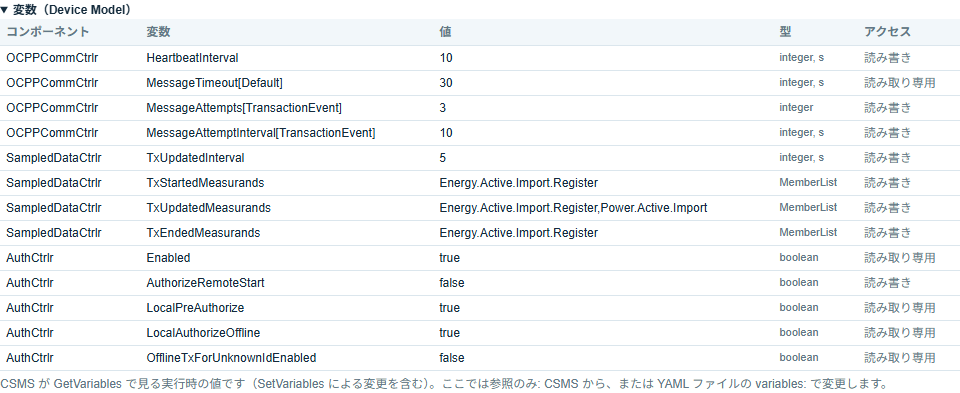

# クイックスタート

SME OCPPSim が模擬するのは **Charge Point（充電器）** 側です。充電器の接続先として CSMS（中央システム）が必要です。
以下の例ではオープンソースの OCPP 1.6 CSMS である [SteVe](https://github.com/steve-community/steve) を使いますが、
OCPP 1.6J に対応した CSMS であれば何でも使えます。

## Windows 実行ファイル

[最新リリース](https://github.com/smartedge-tech-dev/sme-ocpp-sim/releases/latest) から
`sme-ocpp-sim-vX.Y.Z-windows.exe` をダウンロードして実行します。`-c` を指定しない場合は同梱のデモ設定
（`configs/demo-site.yaml`）で起動し、<http://127.0.0.1:8082/> の Web UI を開きます。

```powershell
.\sme-ocpp-sim-v0.2.0-windows.exe -c my-site.yaml
```

## pip

Python 3.11 以降が必要です。

```powershell
python -m venv .venv
.venv\Scripts\pip install sme-ocpp-sim
.venv\Scripts\sme-ocpp-sim -c my-site.yaml
```

`pipx install sme-ocpp-sim` でもインストールできます。

## Docker

linux/amd64 と linux/arm64 のイメージを GHCR で公開しています。コンテナが公開するのは Web UI のポート（8082）
だけです。模擬充電器は CSMS へ接続しに行く WebSocket *クライアント* なので、プロトコル用のポートは不要です。

```bash
docker run --rm -p 8082:8082 ghcr.io/smartedge-tech-dev/sme-ocpp-sim
```

コンテナ内の `localhost` はコンテナ自身を指すため、デモ設定の `ws://localhost:8180/...` ではお使いの PC 上の
CSMS に届きません。Docker ホスト上で動く CSMS に接続するには、CSMS の URL に `host.docker.internal` を使います
（例: `ws://host.docker.internal:8180/steve/websocket/CentralSystemService`）。Docker Desktop（Windows / macOS）
ではこの名前が使えます。Linux では `--add-host=host.docker.internal:host-gateway` を追加してください。

```bash
docker run --rm -p 8082:8082 --add-host=host.docker.internal:host-gateway \
  -v "$PWD/site.yaml:/app/configs/site.yaml" \
  ghcr.io/smartedge-tech-dev/sme-ocpp-sim \
  sme-ocpp-sim run -c configs/site.yaml --host 0.0.0.0 --no-browser
```

タイムゾーンは `-e TZ=Asia/Tokyo` で設定できます（既定は UTC）。`docker load -i` 用のオフラインイメージは
各リリースに添付しています。

## コマンドラインオプション

| オプション | 意味 |
|---|---|
| `-c, --config FILE` | YAML 設定ファイル（既定: 同梱の `configs/demo-site.yaml`） |
| `--host 127.0.0.1` | Web UI の待ち受けアドレス（既定は localhost のみ。`0.0.0.0` で LAN に公開） |
| `--http-port 8082` | Web UI のポート |
| `--no-browser` | 起動時にブラウザを開かない |
| `-v, --verbose` | デバッグログ |
| `--version` | バージョンを表示 |

## SteVe への初回接続

1. SteVe を起動します。デモ設定は `ws://localhost:8180/steve/websocket/CentralSystemService` を想定しています。
2. SteVe でチャージボックス ID `CP-0001`、`CP-0002`、`CP-0003` を登録します。未登録の ID は WebSocket
   ハンドシェイクで HTTP 404 として拒否され、UI にはハンドシェイクエラーとして表示されます。
3. Authorize で Accepted を返させたい場合は、OCPP タグ `04A1B2C3` と `TAG-0002` を登録します。
4. SME OCPPSim を起動します。各充電器が接続し、BootNotification と StatusNotification を送り、以降は Heartbeat を送ります。
5. Web UI でコネクターに EV を接続し、タグをかざしてトランザクションを開始します。MeterValues がフレームログに、
   トランザクションが SteVe に表示されます。
6. SteVe から充電中のコネクターへ SetChargingProfile を送ると、Smart Charging パネルで電力が制限値に追従する様子を確認できます。

別の CSMS を使う場合は、YAML ファイルまたは UI の設定ダイアログで `csms_defaults.url` を変更します。
充電器 ID は URL の最後のパスセグメントとして付加されます。

## OCPP 2.0.1 の充電器 { #ocpp-201 }

2.0.1 の Charging Station には OCPP 2.0.1（サブプロトコル `ocpp2.0.1`）に対応した CSMS が必要です。
`ocpp_version` は充電器ごと（または `csms_defaults` で全体）に指定するため、1.6 と 2.0.1 の充電器をそれぞれの
`csms_url` で同時に動かせます。

```yaml
csms_defaults:
  url: "ws://localhost:8180/steve/websocket/CentralSystemService"   # OCPP 1.6 CSMS
  ocpp_version: "1.6"

chargers:
  - id: "CP-0001"                     # OCPP 1.6J
    max_power_w: 6000
    id_tags: ["04A1B2C3"]
  - id: "CS-2001"                     # OCPP 2.0.1, two EVSEs
    ocpp_version: "2.0.1"
    csms_url: "ws://localhost:9000/ocpp"
    connectors: 2
    max_power_w: 7400
    id_tags: ["04A1B2C3"]
    variables:
      - { component: OCPPCommCtrlr, variable: HeartbeatInterval, value: 120 }
```

完全な例は [`configs/mixed-site.yaml`](https://github.com/smartedge-tech-dev/sme-ocpp-sim/blob/main/configs/mixed-site.yaml) です。2.0.1 の URL はお使いの CSMS の Charging Station 用
エンドポイントに置き換えてください。1.6 と同様、ステーション ID が URL の最後のパスセグメントとして付加されます。
バージョンは UI の設定ダイアログでも変更できます（充電器は再接続します）。

2.0.1 の充電器では、Web UI は次のように表示します。

- 充電器一覧と詳細ヘッダーに OCPP バージョン
- コネクターの代わりに EVSE（`connectors: N` = 1 コネクターの EVSE が N 個）
- 設定キーの代わりに **変数（Device Model）**: CSMS が GetVariables で読む実行時の値（SetVariables による変更を
  含む）。表は参照のみです（HTTP API に変数を変更するルートはありません）。値は CSMS から、または YAML ファイルの
  `variables:` で変更します
- Smart Charging パネルの **外部制限値（EMS）** 操作。[Smart Charging](smart-charging.md#ocpp-201) を参照

故障ダイアログには充電器のバージョンの故障コードが表示されます。2.0.1 の StatusNotification にはエラーコードが
ないため、2.0.1 の故障では EVSE を Faulted と通知し、コードは中断したトランザクションの `stoppedReason` としてのみ
送信します。


