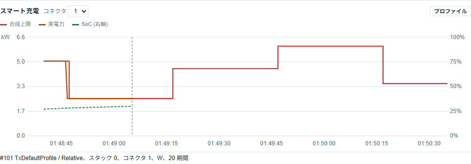

# Smart Charging

SME OCPPSim は OCPP 1.6 の Smart Charging プロファイル（SetChargingProfile、ClearChargingProfile、
GetCompositeSchedule、RemoteStartTransaction に含まれる充電プロファイル）を実装しています。

## 計画と電力を 1 つの評価関数で

電力モデルが毎 tick 適用する制限値は、1 秒間の複合スケジュールの最初の期間であり、GetCompositeSchedule に応答するのと
同じ関数で計算されます。そのため、CSMS に報告する計画と、模擬 EV が実際に引き込む電力（MeterValues に現れる値）が
食い違うことはありません。

各 tick の処理: 複合スケジュールの制限値 → `min(ハードウェア上限, 制限値, EV の受入電力)` → 電力（ランプ設定があれば適用）
→ 電力量レジスタと SoC。新しいプロファイルは CALLRESULT を送った直後の tick から有効になります。
制限値が 0 または EV の最小使用電力を下回るとコネクターは **SuspendedEVSE** に、EV が満充電（目標 SoC）に達するか
最小値を下回るまでテーパーすると **SuspendedEV** になります。

`simulation.time_scale` が加速するのは電力モデル（ランプ、電力量、SoC）だけです。スケジュールは CSMS の時刻で
表されるため、プロファイルは実時間で評価します。Relative の 60 秒の期間は、time_scale に関係なく実時間で 60 秒続きます。

## 仕様に基づいて実装したルール

参照先は OCPP 1.6 edition 2 とその errata sheet v4.0 です。

- **3.13.1**: ChargePointMaxProfile はコネクター 0 のみ。TxProfile は connectorId > 0 で、そのコネクターでトランザクションが
  実行中の場合のみ。TxProfile はトランザクション終了時に無効になります（7.10）。
- **3.13.2 / 5.16.3 / 5.16.4**: 新しいプロファイルは、同じ chargingProfileId、または同じ stackLevel と purpose を持つ
  インストール済みのプロファイルを置き換えます。
- **3.13.2**: purpose ごとに、有効期間内（validFrom / validTo）で stackLevel が最も高いプロファイルが優先されます。その
  スケジュールが動作していない（未開始、`duration` 経過）ときは、次に低い stackLevel が適用されます（errata 3.43）。
  プロファイルがなければ制限はありません。
- **3.13.1 / 3.13.3**: 現在のトランザクションでは TxProfile が TxDefaultProfile より優先され、その結果と
  ChargePointMaxProfile の小さい方が適用されます。コネクター固有の TxDefaultProfile は、同じ stackLevel のコネクター 0 用の
  ものを、そのコネクターに限って置き換えます。
- **7.9 / 7.13**: Absolute は `startSchedule` から開始します。Relative と `startSchedule` のない Absolute はトランザクション
  開始時刻から開始します。Recurring は毎日 / 毎週繰り返し、繰り返し周期より長い `duration` は周期で切り詰めます
  （errata 3.43 / 3.44）。最初の期間は 0 から始まり（errata 3.45）、stackLevel ≥ 0 です（7.8）。
- **7.12 / 7.14**: W = A × 電圧 × 相数。相数は `numberPhases`、省略時は 3。errata 3.34: 充電器より多い相数のプロファイルは、
  実際に使える相に制限値を適用します。
- **6.13 / errata 3.25–3.26**: フィールドなしの ClearChargingProfile はすべてを削除します。それ以外は指定したフィールドの AND
  条件で、`id` を指定した場合は他のフィールドを無視します。該当なしは `Unknown`（7.21）。
- **5.7**: 複合スケジュールは [開始, 開始 + duration) を対象とし、connectorId 0 は充電器全体を報告します。
- 不正な `chargingRateUnit`（他の不正な列挙値と同様）は CALLERROR `PropertyConstraintViolation` になります（errata 3.24）。

## 本実装での解釈

仕様が明確に定めていない点について、本実装では次のように判断しています。「確認した仕様」は確認した箇所です。

| 項目 | 解釈 | 確認した仕様 |
|---|---|---|
| トランザクションがない場合の Relative | トランザクションのないコネクターでは、Relative（および `startSchedule` のない Absolute）は要求された期間の開始を起点とします。ChargePointMaxProfile は常に期間の開始を起点とします。そのため、トランザクションがないときの実際の制限値は Relative スケジュールの最初の期間になります | 5.7、7.13 |
| `startSchedule` のない Recurring | 00:00 UTC（Daily）または月曜 00:00 UTC（Weekly）を基準にします。繰り返しは `startSchedule` より前にも及びます（`startSchedule` は時刻 / 曜日を決めるだけ） | 7.8、7.9 |
| validFrom / validTo | validFrom は含み、validTo は含みません | 7.8 |
| connectorId 0 の複合スケジュール | min(ChargePointMax, コネクター 1..N の TxProfile / TxDefault 制限値の合計)。制限のないコネクターが 1 つでもあれば合計は無制限です。アイドル中のコネクターも TxDefault の制限値で（なければ無制限として）計上するため、値は現在の引込電力ではなく充電器が引き込み *うる* 最大値です。単一コネクターには ChargePointMax の値をそのまま割り当てます（コネクター間の配分はしません） | 5.7、3.13.3 |
| `minChargingRate` | 制限値は変えません。それを下回る電力で充電しないのは EV モデルの役割です | 7.13 |
| GetCompositeSchedule の「制限なし」 | 制限のない区間は充電器のハードウェア上限（`max_power_w`、connectorId 0 ではコネクター数倍）として報告します。そのため、プロファイルがなくても応答は Accepted です（1.6 には「制限なし」の表現がありません） | 5.7 |
| GetCompositeSchedule の応答 | `scheduleStart` = `chargingSchedule.startSchedule` = 要求の時刻、`duration` = 要求された duration、制限値は小数 1 桁に丸め、丸め後に同じ値になった隣接期間は結合します。未知のコネクターや duration < 1 は Rejected | 5.7、7.13 |
| 秒の途中にある期間境界 | 次の整数秒から開始します（`startPeriod` は整数） | 7.13 |
| 単位の指定がない場合 | W | 7.13 |
| A 単位の制限値と相数 | EV の充電中は EV が使う相に、それ以外は電源の相に適用します | errata 3.34 |
| 置き換えの範囲 | 同じ stackLevel + purpose による置き換えは connectorId ごとに行います（コネクター固有の TxDefaultProfile はコネクター 0 用のものを「そのコネクターに限って」置き換えるため） | 3.13.1 |
| 別トランザクション向けの TxProfile | `transactionId` がコネクターの実行中トランザクションと異なる TxProfile は Rejected | 3.13.1 |
| 不正なプロファイル | `recurrencyKind` のない Recurring、単調増加でない `startPeriod`、空の期間リスト、0..N 以外の connectorId、`validTo` ≤ `validFrom` は Rejected | 7.13 |
| スキーマにない値の範囲 | 負の `limit` / `startPeriod` / `minChargingRate`、1..3 以外の `numberPhases`、`duration` ≤ 0 は Rejected | 7.13、7.14 |
| RemoteStartTransaction のプロファイル | `transactionId` のない TxProfile でなければなりません（「SHALL NOT be set」）。それ以外はトランザクションを開始せず Rejected。StartTransaction の応答後、新しい transactionId に紐付けてインストールします | 5.16.2、6.33 |
| 範囲外のコネクター | 0..N 以外の connectorId を指定した SetChargingProfile / ClearChargingProfile は、他のコネクター指定の要求と同様に CALLERROR `PropertyConstraintViolation` | — |
| オフライン期間 | tick は接続中にだけ動作します。オフライン後の最初のステップは、再接続時点で有効な制限値でその期間を積算します | — |

## 電力モデルの約束事

以下は OCPP の規定ではなく、シミュレーターとしての約束事です。

- 電力は `相電圧 × 電流 × 相数` です。三相電源で `line_to_line: true` のときは相電圧 = `voltage_v / √3` となり、
  P = √3 × 線間電圧 × 電流 です。使用する相数 = min(EV の相数, 電源の相数)。
- 電力量は台形則で積算し、電力量レジスタは増える一方です。SoC は目標を最大 1 ステップ分超えることがあります。
- ランプ（`ramp_up_w_per_s`、`ramp_down_w_per_s`）の単位は模擬時間 1 秒あたりの W で、既定はステップ変化です。

## OCPP 2.0.1 { #ocpp-201 }

2.0.1 の充電器はこのルールの独立したコピー（`protocol/v201/profiles.py` / `composite.py`）を持ちます。電力モデルは
共通なので同じ閉ループが成り立ちます: GetCompositeSchedule の値は、その後の TransactionEvent の
`Power.Active.Import` と一致します。メッセージ: SetChargingProfile、ClearChargingProfile、GetCompositeSchedule、
GetChargingProfiles（EVSE と `chargingLimitSource` ごとに 1 通の ReportChargingProfiles で応答、最後以外は
`tbc`）、NotifyChargingLimit、ClearedChargingLimit、RequestStartTransaction の `chargingProfile`（開始した
トランザクションに紐付けて設定）。

| 項目 | 動作（スキーマで決まらない部分は本実装の解釈） |
|---|---|
| Purpose | ChargingStationMaxProfile（evseId 0 のみ、Relative 不可: K01.FR.38）、TxDefaultProfile、TxProfile（evseId > 0、その EVSE の実行中トランザクションの `transactionId` が必要。なければ `TxNotFound`、K01.FR.09）、ChargingStationExternalConstraints（CSMS からは不可: `UnsupportedPurpose` で Rejected、errata K01.FR.62） |
| EVSE の制限値 | min(ChargingStationMax、evseId 0 と当該 EVSE の外部制約、TxProfile なければ TxDefaultProfile) |
| evseId 0 | min(ChargingStationMax、evseId 0 の外部制約、各 EVSE 制限値の合計)。制限のない EVSE があれば無制限 |
| stackLevel の衝突 | 同じ EVSE・purpose・stackLevel で有効期間が重なる別プロファイル（K01.FR.06）、有効期間に関係なく stackLevel と `transactionId` が同じ TxProfile（K01.FR.39）、evseId 0 と個別 EVSE で同じ stackLevel の TxDefaultProfile（K01.FR.52 / FR.53）は `DuplicateProfile` で Rejected（同じ id は置き換え） |
| `chargingSchedule` 配列 | スケジュールは 1 つだけ。複数は Rejected（K01.FR.34: ISO 15118 の場合のみ。模擬しない）。`startSchedule` は Absolute / Recurring で必須、Relative では不可（K01.FR.40 / FR.41） |
| ClearChargingProfile | `chargingProfileId` が条件より優先。条件は AND。外部制約は CSMS から削除されない |
| Device Model | SmartChargingCtrlr ProfileStackLevel（100）、PeriodsPerSchedule（1024）、RateUnit（`A,W`。それ以外の単位は `UnsupportedRateUnit`、GetCompositeSchedule でも同様、K08.FR.07）を適用。ExternalControlSignalsEnabled が `false` なら外部制限値を拒否。NotifyChargingLimitWithSchedules で NotifyChargingLimit にスケジュールを含めるか決定 |

**外部制限値。** `POST /api/chargers/{id}/external-limit` はエネルギーマネジメントシステムの代わりです。EVSE または
ステーションに ChargingStationExternalConstraints プロファイル（stackLevel 0、W の 1 期間、負のプロファイル id）を
設定し、NotifyChargingLimit（`chargingLimitSource` `EMS`）を送信します。解除すると ClearedChargingLimit を送信します。
どちらも Boot が受理されている間だけ送信されます（オフラインで設定した値は適用されますが後から報告されません）。
GetChargingProfiles はこれらを source `EMS`、CSMS のものを `CSO` として報告します。OCPP 1.6 には外部制限値がなく
400 を返します。

トランザクション中に外部制限値の変更で EVSE の充電レートが変わると、TransactionEvent `Updated`（`ChargingRateChanged`）
も送信キューに入ります（K11.FR.04 / K13.FR.03）。

2.0.1 の規則は OCPP 2.0.1 Edition 4（Part 2 K01 / K08 / K10 / K11 / K13、errata 2026-09）で確認済みです。
要件 ID は `protocol/v201/profiles.py` と `composite.py` の docstring にあります。

Web UI では、2.0.1 の充電器の Smart Charging パネルに **外部制限値（EMS）** の行があります。ステーション全体（0）
または EVSE を選び、W 単位の制限値を入力して「設定」、または「解除」を押します。外部制約プロファイルはプロファイル
一覧に表示され、グラフの合成制限値にも反映されます。

