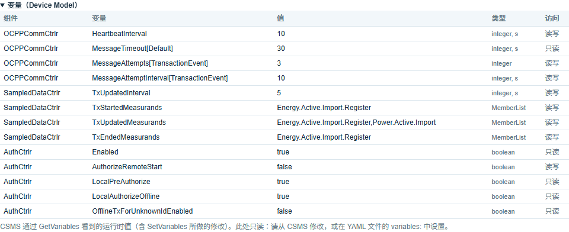

# 配置

模拟器读取一个 YAML 文件（`-c FILE`）。所有块都可省略；未知字段会报错。完整示例见
[`configs/demo-site.yaml`](https://github.com/smartedge-tech-dev/sme-ocpp-sim/blob/main/configs/demo-site.yaml)。

```yaml
simulation:
  tick_seconds: 1
  time_scale: 1
  running: true

frame_log:
  size: 20000

csms_defaults:
  url: "ws://localhost:8180/steve/websocket/CentralSystemService"
  ocpp_version: "1.6"
  security_profile: 0
  reconnect: { min_s: 1, max_s: 60, jitter: 0.2 }

ev_models:
  - id: "demo-60kwh"
    capacity_kwh: 60
    max_ac_kw: 11
    max_current_a: 16
    phases: 3

chargers:
  - id: "CP-0001"
    max_power_w: 6000
    id_tags: ["04A1B2C3", "TAG-0002"]
    config_keys:
      HeartbeatInterval: 300
```

!!! warning "ID、标签和密码请加引号"
    在 YAML 1.1 中，不加引号的 `0123`、`1e5`、`ON`、`OFF`、`yes`、`no` 都不是字符串。标识和文本字段
    （`id`、`id_tags`、`password`、URL、`vendor` 等）只接受加引号的字符串，并提示你加上引号，而不会悄悄把 `0123` 变成 `83`。

## 从 Web UI 保存 { #saving-from-the-web-ui }

在 UI 中的修改会立即生效（只有被修改的充电桩会重连），也可以保存回 YAML 文件。保存时，会把发生变化的顶层块
（`simulation`、`frame_log`、`csms_defaults`、`ev_models`、`chargers`）整块替换：

- 变化块**之外**的注释会保留，文件的换行符和 UTF-8 BOM 也会保留。
- 变化块**之内**的注释会丢失。任意一台充电桩被修改时，整个 `chargers:` 块都会被重写，所以**不要在单台充电桩的条目里写注释**——
  请写在 `chargers:` 键的上方。
- 与默认值相同的值不会写出。
- 如果某个块无法拼接（不常见的排版），会重写整个文档并丢失所有注释，同时在日志中输出警告。

HTTP API 不会返回密码，而是显示为 `********`。带着掩码原样发回配置时，会保留已保存的密码。

## simulation

| 字段 | 默认值 | 含义 |
|---|---|---|
| `tick_seconds` | `1.0` | 功率模型的步长（秒，> 0） |
| `time_scale` | `1.0` | 只加速功率模型（爬坡、电能寄存器、SoC）。充电计划和 OCPP 时序始终使用真实时间 |
| `running` | `true` | `false` 冻结功率模型；OCPP 会话继续运行 |

## frame_log

| 字段 | 默认值 | 含义 |
|---|---|---|
| `size` | `20000` | 内存中保留的 OCPP 帧数（所有充电桩合计，≥ 100） |

## csms_defaults

| 字段 | 默认值 | 含义 |
|---|---|---|
| `url` | 无 | CSMS 的 WebSocket URL（`ws://` 或 `wss://`）；充电桩 ID 作为最后一段路径追加。除非每台充电桩都有 `csms_url`，否则必填 |
| `ocpp_version` | `"1.6"` | `"1.6"`、`"2.0.1"` 或 `"2.1"` |
| `security_profile` | `0` | `0`、`1`、`2` 或 `3`；每台充电桩都按它检查，见 [安全配置文件](security-profiles.md) |
| `reconnect.min_s` | `1.0` | 首次重连等待时间（秒） |
| `reconnect.max_s` | `60.0` | 重连等待时间上限（≥ `min_s`）；等待时间按指数增长 |
| `reconnect.jitter` | `0.2` | 等待时间的随机波动（0–1） |
| `reconnect.max_retries` | `null` | 连续连接失败（握手失败，或在 Boot Accepted 之前就断开的连接）的上限。超过后充电桩停止重试，UI 显示 **已放弃重试**，只有点击 连接 才会重新开始。`null` = 不限，`0` = 首次失败即停止 |

## ev_models

自定义 EV 模型，由 `session.ev_model` 引用。同 ID 的条目会覆盖内置预设。
内置预设见[车辆池](#vehicle-pool)。

| 字段 | 默认值 | 含义 |
|---|---|---|
| `id` | 必填 | 唯一 ID（加引号的字符串） |
| `capacity_kwh` | 必填 | 电池容量 |
| `max_ac_kw` | 必填 | AC 最大充电功率 |
| `max_current_a` | `32.0` | 每相最大电流 |
| `max_dc_kw` | 无 | 为向前兼容而接受；v0.1 不模拟 DC 充电 |
| `phases` | `1` | 车载充电机使用的相数（1、2 或 3） |
| `min_current_a` | `6.0` | 每相电流低于此值时 EV 无法充电（≤ `max_current_a`） |
| `efficiency` | `0.9` | 进入电池的能量比例（0–1] |
| `curve` | 内置 | `[SoC %, 相对最大值的比例]` 对的列表（充电衰减曲线） |
| `weight` | `1` | 车辆池中的权重（`session.ev_model: pool`）；`0` = 不会被抽中 |
| `initial_soc` | 充电桩的 `session.initial_soc` | 从池中抽中时的初始 SoC：数值（固定）或分布（见下） |
| `target_soc` | 充电桩的 `session.target_soc` | 从池中抽中时的目标 SoC：数值或分布 |

### 车辆池 {#vehicle-pool}

`session.ev_model: pool` 时，每笔新交易都从车辆池中抽一台 EV：池由内置预设和 `ev_models` 条目组成（与预设同
ID 的条目替换该预设），按 `weight` 加权抽取。初始 SoC 与目标 SoC 取自抽中的条目。SoC 分布是一个映射：

| 键 | 默认值 | 含义 |
|---|---|---|
| `dist` | `uniform` | `fixed`（`mean`）、`[min, max]` 上的 `uniform`，或截断到 `[min, max]` 的 `normal`（`mean`、`sd`）。省略 `dist` 却写了 `mean` / `sd` 时报错（不做推测） |
| `min` / `max` | `0` / `100` | 范围（%） |
| `mean` | 无 | 固定值或正态均值（须在 `[min, max]` 内；`uniform` 不可指定） |
| `sd` | 无 | `normal` 的标准差（≥ 0） |

```yaml
ev_models:
  - id: my-van
    capacity_kwh: 75
    max_ac_kw: 11
    phases: 3
    weight: 2
    initial_soc: {dist: normal, mean: 35, sd: 10, min: 5, max: 80}
    target_soc: 90
chargers:
  - id: CP001
    session: {ev_model: pool}
```

抽取是确定性的：每个 connector 有独立的随机流 `vehicle:{charger}:{connector}`，增加充电桩不影响其它桩的序列。
种子为 `traffic.seed`（默认 0，参见[流量生成器](traffic.md)），即时生效：新的种子让随机流从头开始。
随机流在充电桩启动时开始；重启或会重建充电桩的配置变更（例如编辑 `ev_models`）会从头重放。每次抽取恰好消耗
3 个随机数（车辆、初始 SoC、目标 SoC），因此修改某条目的分布只改变从该条目抽出的值，不影响之后的抽取；修改权重或
条目列表则会改变抽中的车辆。数值四舍五入到 0.01 %。

当条目的初始 SoC 可能超过目标 SoC 时（两者都设置时；分布取其 `max` 与目标的 `min` 比较），加载 YAML 文件会记录
警告：这样的会话从目标之上开始，不接受功率（SuspendedEV）。

预设（抽象的车辆类别，不对应真实车型；池中权重、初始 SoC；目标 SoC 为充电桩的 `session.target_soc`）：

| 预设 | 电池、AC | 权重 | 初始 SoC |
|---|---|---|---|
| `kei-20kwh` | 20 kWh、3 kW、15 A、单相 | 2 | uniform 10–60 % |
| `compact-40kwh` | 40 kWh、6 kW、30 A、单相 | 3 | uniform 10–60 % |
| `midsize-60kwh` | 60 kWh、11 kW、16 A、三相 | 2 | uniform 10–60 % |
| `suv-90kwh` | 90 kWh、11 kW、16 A、三相 | 1 | normal 40 ± 15，10–80 % |
| `phev-12kwh` | 12 kWh、3.2 kW、16 A、单相 | 1 | uniform 0–40 % |
| `van-75kwh` | 75 kWh、11 kW、16 A、三相、效率 0.88 | 1 | normal 30 ± 10，5–70 % |

## chargers

| 字段 | 默认值 | 含义 |
|---|---|---|
| `id` | 必填 | 充电桩 ID（加引号的字符串）。用作 URL 的最后一段路径和 Basic 认证的用户 ID，因此不能包含 `:`；`bulk` 为保留字 |
| `csms_url` | `csms_defaults.url` | 单台充电桩的 CSMS URL |
| `ocpp_version` | `csms_defaults.ocpp_version` | 单台充电桩的 OCPP 版本（`"1.6"` 或 `"2.0.1"`）；同一站点可以混用 |
| `password` | 无 | Basic 认证密码（Security Profile 1 / 2） |
| `ca_file` | 系统信任库 | `wss://` 时用于校验 CSMS 证书的额外 CA 证书包（PEM） |
| `client_cert_file` | 无 | Security Profile 3：充电桩的 TLS 客户端证书（PEM，可为证书链） |
| `client_key_file` | 无 | Security Profile 3：其私钥（PEM，不加密） |
| `verify_tls` | `true` | `false` 跳过证书校验（仅限测试；日志中会输出警告） |
| `require_subprotocol` | `true` | `false` 时即使 CSMS 未回显 `ocpp1.6` / `ocpp2.0.1` 子协议也保持连接 |
| `vendor` | `"SmartEdge"` | BootNotification 的 `chargePointVendor`（最多 20 个字符） |
| `model` | `"SIM-AC6"` | `chargePointModel`（最多 20） |
| `serial` | 无 | `chargePointSerialNumber`（最多 25） |
| `firmware` | `"0.1.0"` | `firmwareVersion`（最多 50） |
| `connectors` | `1` | connector 数量（1–32）；所有 connector 共用下面的供电设置和 `max_power_w`。OCPP 2.0.1：EVSE 数量（每个一个 connector） |
| `config_keys` | `{}` | OCPP 1.6：配置键初始值，例如 `HeartbeatInterval: 300`；数字和布尔值可以不加引号。2.0.1 充电桩不使用（见 `variables`）。`AuthorizationKey` 不能在这里设置（使用 `password`）；Security Whitepaper 的键 `SecurityProfile`（只读，当前使用的 Profile）、`CpoName`（默认 `vendor`）、`CertificateStoreMaxLength`、`AdditionalRootCertificateCheck`（`false`）也在其中 |
| `auth_mode` | `local_then_csms` | `local_only`（仅 `id_tags`）、`csms_only`（始终 Authorize）、`local_then_csms`（先查 `id_tags`，再 Authorize）、`accept_all` |
| `id_tags` | `[]` | 本地接受的 ID 标签（每个最多 20 个字符，不可重复） |
| `boot_retry_s` | `60.0` | CSMS 以 interval 0 应答 Pending / Rejected 时的 Boot 重试间隔 |
| `boot_max_retries` | `null` | 非 Accepted 的 BootNotification 应答（Pending、Rejected 或无应答，跨重连累计直到 Accepted）的上限。超过后关闭连接，并像 `reconnect.max_retries` 一样停止。`null` = 不限（符合 OCPP）；TriggerMessage 触发的 BootNotification 不计入。若 CSMS 反复应答 Pending 后断开连接，则同时计入两个上限（每次 Boot、每次断开） |
| `max_power_w` | `6000.0` | 每个 connector 的硬件最大功率 |
| `voltage_v` | `200.0` | 供电标称电压 |
| `phases` | `1` | 供电相数（1、2 或 3） |
| `line_to_line` | `false` | `true` 表示三相供电的 `voltage_v` 为线电压（例如日本三相 200 V 三角形接法）；相电压 = `voltage_v / √3` |
| `ramp_up_w_per_s` | 无 | 每模拟秒的功率上升量（W）；无 = 阶跃变化 |
| `ramp_down_w_per_s` | 无 | 功率下降量；无 = 阶跃变化（限值降低在一个 tick 内生效） |
| `session.ev_model` | `compact-40kwh` | 插在 connector 上的 EV（预设或 `ev_models` 的 ID），或 `pool`：每笔交易从[车辆池](#vehicle-pool)中抽一台 |
| `session.initial_soc` | `30.0` | 每次交易开始时的 SoC（%）；`pool` 时为未设 `initial_soc` 的 `ev_models` 条目的默认值 |
| `session.target_soc` | `90.0` | 达到后 EV 不再接受功率（SuspendedEV） |
| `meter.begin_end_messages` | `false` | OCPP 1.6：在被接受的 StartTransaction 之后再发一条 context 为 `Transaction.Begin` 的 MeterValues，在 StopTransaction 之前发一条 `Transaction.End`（measurand 取自 `MeterValuesSampledData`）。OCPP 2.0.1 始终在 `Started` / `Ended` 事件里带这些值 |
| `meter.phase_values` | `off` | `off`：不带 phase 的一个 `Voltage` 和一个均衡的 `Current.Import`。`L-N`：每个供电相一个 `Voltage`（`L1-N`、`L2-N`、`L3-N`）；`L-L`：三相供电时报线电压（`L1-L2`、`L2-L3`、`L3-L1`，相电压的 √3 倍），单相 / 两相时同 `L-N`。两种模式下 `Current.Import` 都按供电相报（`L1`..，EV 未使用的相为 0 A）。使用 `voltage_v` / `phases` / `line_to_line` |
| `meter.post_tx_delay_s` | `0` | 交易结束到发送其 StopTransaction（1.6）/ `Ended` TransactionEvent（2.0.1）之间的秒数。发送队列保持顺序，排在它之后的所有消息都一起等待：Finishing 的 StatusNotification，以及延迟期间新开始的交易的 StartTransaction / `Started`。Reset 最多只等调用超时让队列清空，所以延迟更长时，被 Reset 结束的交易的 StopTransaction / `Ended` 不会在重启前发出，而是留在队列里，在下一次被接受的 BootNotification 之后发送 |
| `meter.tx_data_max_samples` | `1000` | 每笔交易为 StopTransaction `transactionData` / `Ended` `meterValue` 分别保留的采样读数与时钟对齐读数上限（1–10000），超出时丢弃最旧的，每笔交易记一次警告日志。开始和结束读数不计入。读数在功率模型 tick（`simulation.tick_seconds`）上采集，分辨率受 tick 限制：每个 tick 每条流最多一个读数，时间戳为区间边界 |
| `impairments.block` | `{}` | 命令屏蔽（模拟器专有）：CSMS → 充电桩的 action 名 → `NotImplemented` / `NotSupported`（以该 CALLERROR 应答）或 `NoReply`（不应答，CSMS 侧超时）。只能是该充电桩 OCPP 版本接收的 action。不重连即作用于运行中的充电桩；见 [HTTP API](http-api.md#command-blocking-and-frame-injection) |
| `impairments.latency_ms` / `jitter_ms` | `0` / `0` | 网络延迟（模拟器专有）：`impairments.direction`（`both` / `tx` = 发送 / `rx` = 接收）方向的每一帧延迟 `latency_ms` ± `jitter_ms`（均匀分布；`jitter_ms` ≤ `latency_ms`）。保持帧顺序：较短的延迟排在前一帧较长的延迟之后。延迟由以 `impairments.seed`（`null` = 充电桩 ID 的 CRC32）为种子的随机数决定，可复现；随机数每次连接从头开始，`seed` 的修改从下一次连接起生效。调低或关闭延迟时，正在等待的帧立即放行。连接断开时仍在等待的发送帧会丢失，与真实网络相同。WebSocket 的 ping / pong 不受影响 |
| `impairments.drop_every_s` / `drop_jitter_s` | `null` / `0` | 周期断线：每次连接后经过 `drop_every_s` ± `drop_jitter_s` 秒断开（`null` = 关；`drop_jitter_s` < `drop_every_s`）。修改 `drop_every_s`、`drop_jitter_s` 或 `seed` 会让当前周期重新计时（修改其他字段不会） |
| `impairments.drop_mode` / `down_s` | `abort` / `5` | 模拟断线的方式：`abort` 不发 close 帧直接切断 TCP 连接（模拟拔网线），`close` 以代码 1001 正常关闭；`down_s`：断线后到重连前的等待时间（也是 `POST /api/chargers/{id}/drop` 的缺省值）。模拟断线**不算**连接失败：不计入 `reconnect.max_retries` / `boot_max_retries`，也不走 back-off；交易与待发消息保留，在下一次连接时发出（`last_error` 的 kind 为 `simulated_drop`）。`impairments` 的所有字段都不重连即生效 |
| `impairments.remote_start` | `normal` | `accept_no_tx`：对 RemoteStartTransaction（1.6）/ RequestStartTransaction（2.0.1）回 `Accepted`，但什么都不启动：不发 StartTransaction / TransactionEvent `Started`，connector 状态不变。CSMS 看到的是一个被接受却从未发生的启动 |
| `impairments.meter.drop_ratio` | `0` | 周期计量消息（1.6 MeterValues `Sample.Periodic`、2.0.1 TransactionEvent `Updated` / `MeterValuePeriodic`）不发送的比例（0–1）。2.0.1 被丢弃的 event 仍占用 `seqNo`：CSMS 能看到缺口 |
| `impairments.meter.reorder_window` | `0` | 攒够这么多条周期计量消息后按随机顺序发出（时间戳与 `seqNo` 保持原值）；`0` / `1` = 关。攒着的消息在交易结束消息之前发出 |
| `impairments.meter.end_after_stop` | `false` | 最后一条计量值在 StopTransaction / Ended event 之后才到（SAP `outOfOrderEndMeterValues`）：1.6 把 `Transaction.End` 的 MeterValues（`meter.begin_end_messages`）或停止时刻的一条 `Sample.Periodic` 放到 StopTransaction 之后；2.0.1 发一条 `Updated` event（`seqNo` 紧接 Ended） |
| `impairments.meter.voltage_noise_v` | `0` | 给每个上报的 Voltage 加均匀分布 ± 噪声（V） |
| `impairments.response_delay_ms` | `{}` | CSMS → 充电桩的 action 名 → ms：只把对该 CALL 的应答（CALLRESULT 或 CALLERROR）延迟这么久，其它帧不受影响。超过 CSMS 超时即「慢响应」。未知 action 与 `block` 一样返回 `400` |
| `template` | 无 | 充电桩模板（内置或用户模板，见 [Excel 与模板](excel-templates.md)）；本充电桩未设置的模板字段取模板的值 |
| `params` | `{}` | 含 `{param}` 占位符的用户模板的参数 |
| `meter_sample_interval_s` | 键的默认值 | `config_keys` 未设置时 `MeterValueSampleInterval` 的默认值；2.0.1 为 `SampledDataCtrlr.TxUpdatedInterval` 的初始值 |
| `variables` | `[]` | 仅 OCPP 2.0.1 充电桩：Device Model 的值覆盖与用户自定义变量（见下文） |

### variables（OCPP 2.0.1） { #variables }

2.0.1 充电桩用 Device Model 代替 `config_keys`。它自带模拟器实际使用的最小标准变量集，例如
`OCPPCommCtrlr.HeartbeatInterval`、`SampledDataCtrlr.TxUpdatedInterval`（初始值为 `meter_sample_interval_s`，
未设置则为 60）和 `TxUpdatedMeasurands`、`AuthCtrlr.AuthorizeRemoteStart`、`TxCtrlr.StopTxOnInvalidId`、
`OCPPCommCtrlr.MessageAttempts[TransactionEvent]`、`DeviceDataCtrlr.ItemsPerMessage[GetReport|GetVariables|SetVariables]`、
认证控制变量 `AuthCtrlr.Enabled` / `LocalPreAuthorize` / `LocalAuthorizeOffline` / `OfflineTxForUnknownIdEnabled` /
`DisableRemoteAuthorization`（ReadWrite；初始值由 `auth_mode` 决定，SetVariables 修改后立即生效）、
`SmartChargingCtrlr.Enabled`（ReadWrite，不影响行为）和 `NotifyChargingLimitWithSchedules`（默认 `false`）、
`SecurityCtrlr.SecurityProfile` / `Identity` / `BasicAuthPassword`（新密码被接受后充电桩用它重新连接，仅保存在内存中），
以及必需的 ChargingStation / EVSE / Connector 变量（`Available`、`AvailabilityState`、EVSE 的 `Power` 和
`SupplyPhases`）。OCPP 2.0.1 要求的其他变量（例如 `OCPPCommCtrlr.OfflineThreshold`、`TxCtrlr.EVConnectionTimeOut`、
`SmartChargingCtrlr.Entries[ChargingProfiles]`）以描述模拟器行为的值作为只读变量报告。CSMS 用 GetVariables / SetVariables 读写，用 GetBaseReport 获取列表；
`GET /api/chargers/{id}/configuration` 在 `variables` 中显示它们。SetVariables 的修改不会写回 YAML 文件。

`variables` 的每一项指向一个变量：`component`、可选的 `component_instance`、`evse`、`connector`、`variable`、
可选的 `variable_instance`。

- 指向标准变量的项设置它的 `value`（`Actual` 属性）。由其它设置推导出的变量（`auth_mode`、充电桩 ID、CSMS URL、
  EVSE 状态、交易开始 / 结束点）不能设置。
- 其它项是用户自定义变量，需要 `data_type`（`string`、`decimal`、`integer`、`dateTime`、`boolean`、`OptionList`、
  `SequenceList`、`MemberList`）和 `value`。可选：`mutability`（默认 `ReadWrite`，或 `ReadOnly`、`WriteOnly`）、
  `unit`、`min_limit` / `max_limit`（数值范围；`string` 为长度）、`values_list`（列表类型必填）、
  `target` / `min_set` / `max_set`（更多属性）、`reboot_required`（SetVariables 应答 `RebootRequired`）、
  `persistent`、`constant`、`summary`（包含在 SummaryInventory 报告中）。

```yaml
chargers:
  - id: "CP201"
    ocpp_version: "2.0.1"
    variables:
      - component: OCPPCommCtrlr
        variable: HeartbeatInterval
        value: 120
      - component: DeviceDataCtrlr
        variable: ItemsPerMessage
        variable_instance: GetReport
        value: 10
      - component: VendorCtrlr
        variable: ChargeMode
        data_type: OptionList
        values_list: [Eco, Fast]
        value: Eco
```

加载配置时会校验值（类型、范围、`values_list`）；在 1.6 充电桩上写 `variables` 会报错。

在 Web UI 中，2.0.1 充电桩的 **变量（Device Model）** 表只读显示这些值。



1.6 / 2.0.1 混合站点的示例见 [`configs/mixed-site.yaml`](https://github.com/smartedge-tech-dev/sme-ocpp-sim/blob/main/configs/mixed-site.yaml)。

尚不支持：2.0.1 的 `evses` 树（每个 EVSE 多个 connector）和 `behaviors`。充电桩模板见 [Excel 与模板](excel-templates.md)。


## mini_csms { #mini_csms }

内置简易 CSMS，参见 [Mini CSMS](mini-csms.md)。默认关闭。

| 字段 | 默认值 | 含义 |
|---|---|---|
| `enabled` | `false` | 启动 Mini CSMS WebSocket 服务器 |
| `host` | `"127.0.0.1"` | 监听地址（供其他主机及 Docker 访问时用 `"0.0.0.0"`） |
| `port` | `9000` | 监听端口 |
| `versions` | `["1.6", "2.0.1", "2.1"]` | 接受的 OCPP 版本（子协议协商） |
| `boot.status` | `Accepted` | BootNotification 应答：`Accepted`、`Pending` 或 `Rejected` |
| `boot.interval` | `300` | Heartbeat 间隔（Accepted）或重试间隔（Pending / Rejected），秒 |
| `auth.basic` | `false` | `true` = Security Profile 1：要求 HTTP Basic 认证 |
| `auth.credentials` | `[]` | 每个站点的 `{id, password}`；`basic: true` 时其他 ID 或密码被拒绝（HTTP 401）。Web UI 中掩码显示 |
| `authorize.default` | `Accepted` | 对 ID 标签 / ID 令牌应答的授权状态 |
| `authorize.tags` | `{}` | 按标签覆盖，例如 `{"BAD": "Blocked"}`（2.0.1 专有状态对 1.6 应答为 `Invalid`） |
| `strict` | `false` | 对不符合 schema 的载荷返回 CALLERROR（默认：照常应答并记录警告） |
| `call_timeout_s` | `30` | 发往站点的 CALL 超时 |
| `frame_log_size` | `5000` | Mini CSMS 自有帧日志保留条数 |
| `plan` | `[]` | 计划 CALL：`at_s`、`after`（`boot` / `connect`）、`action`、`payload`，可选 `charger`（模式）与 `ocpp_version` |

修改 `enabled`、`host` 或 `port` 会重启 Mini CSMS（站点重连）；其他修改立即生效（计划的修改从下次连接起）。端口无法绑定时会在
事件日志和面板中提示。
