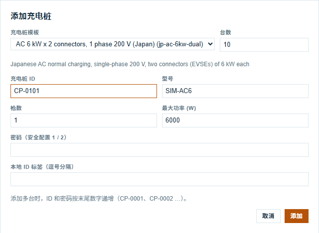

# Excel 导入导出与充电桩模板

充电桩较多的站点用表格维护更方便，同型号的充电桩用模板添加更方便。两者都可以在 Web UI（**文件** 菜单、
**添加充电桩** 对话框）和 [HTTP API](http-api.md#excel-and-templates) 中使用。

## 充电桩模板

充电桩模板是一组型号默认值：厂商 / 型号、枪数、最大功率、供电电压和相数，以及可选的功率爬坡、`auth_mode`、
`config_keys`、`session`、`maintenance` 等字段。充电桩用 `template:` 引用模板，充电桩自身未设置的模板字段取模板的值：

```yaml
chargers:
  - id: "CP-0001"
    template: jp-ac-6kw          # 6 kW，单相 200 V
  - id: "CP-0002"
    template: jp-ac-6kw-dual
    max_power_w: 3000            # 充电桩自身的值优先
```

连接与安全设置（`id`、`csms_url`、`ocpp_version`、`password`、证书）不属于模板，因此每个模板都适用于
OCPP 1.6 和 2.0.1 充电桩。

内置模板（仅交流；不模拟直流充电）：

| 名称 | 型号 | 枪数 | 最大功率 | 供电 |
|---|---|---|---|---|
| `jp-ac-3kw` | `SIM-AC3` | 1 | 3 kW | 单相 200 V、15 A（日本） |
| `jp-ac-6kw` | `SIM-AC6` | 1 | 6 kW | 单相 200 V、30 A（日本） |
| `jp-ac-6kw-dual` | `SIM-AC6D` | 2 | 每枪 6 kW | 单相 200 V（日本） |
| `eu-ac-11kw` | `SIM-AC11` | 1 | 11 kW | 三相 230 / 400 V、16 A |
| `eu-ac-22kw` | `SIM-AC22` | 1 | 22 kW | 三相 230 / 400 V、32 A |

保存配置时，使用模板的充电桩只保留自己的覆盖值（与模板相同的值不写出）。因此之后修改模板，会作用于所有使用它的充电桩。

比较的对象是模板的值：即使等于模型默认值，只要与模板不同也会写出（例如 `eu-ac-11kw` 上的 `phases: 1`、
`jp-ac-6kw-dual` 上的 `connectors: 1`）。`config_keys` / `session` / `maintenance` 按键比较：充电桩只保留自己设置的键，
模板的其他键仍跟随模板。

!!! warning "删除充电桩正在使用的用户模板"
    若删除了充电桩仍在引用的用户模板文件（并重新加载模板），运行中的充电桩保持原值，但配置将无法再加载：启动、
    重新加载配置和 Excel 导入都会以 `charger 'CP1': unknown template 'my-wallbox' (known: ...); restore the user
    template file, or remove 'template' from the charger and set its fields` 失败。请恢复该文件，或从这些充电桩上
    去掉 `template:`（及 `params:`）。

### 用户模板

用户模板是放在 `~/.sme-ocpp-sim/templates/`（或环境变量 `SME_OCPP_SIM_TEMPLATES` 指定的目录）下的 YAML 文件。
与内置模板同名的用户模板会替换内置模板。**文件 → 设备模板 → 另存为设备模板** 把所选充电桩的型号字段写成新的用户模板；
**重新加载用户设备模板** 重新读取该目录。文件格式：

```yaml
name: my-wallbox            # 默认：文件名
title: My 7 kW wallbox
params: {kw: 7}             # 默认值；充电桩可用 params: {kw: 11} 覆盖
model: "WB-{kw}"
max_power_w: "{kw}000"      # 只有一个占位符时保持类型：7000
config_keys: {MeterValueSampleInterval: "60"}
```

允许的键：`name`、`title`、`description`、`params` 以及模板字段 `vendor`、`model`、`firmware`、`connectors`、
`max_power_w`、`voltage_v`、`phases`、`line_to_line`、`ramp_up_w_per_s`、`ramp_down_w_per_s`、`auth_mode`、
`boot_retry_s`、`meter_sample_interval_s`、`require_subprotocol`、`config_keys`、`session`、`maintenance`。
含其他键、或其值构不成有效充电桩的文件会被跳过并报告。

### 批量添加



**添加充电桩** 对话框可以选择模板和台数。添加多台时，ID 和密码按末尾数字递增：首个 ID `CP-0001`、3 台 →
`CP-0001`、`CP-0002`、`CP-0003`；密码 `pass01` → `pass01`、`pass02`、`pass03`（末尾不是数字的密码各台相同）。
末尾不是数字的 ID 作为前缀（`CP-` → `CP-1`、`CP-2` …）。只要有一个新 ID 已存在，就一台也不添加。

## Excel 工作簿

**文件 → 导出 Excel 工作簿（.xlsx）** 把充电桩下载为 `.xlsx`；**导入 Excel 工作簿（.xlsx）** 应用编辑后的工作簿；
**下载空白 Excel 模板** 提供只有表头的工作簿。第 1 行是列名，第 2 行（以 `#` 开头）是简短说明；以 `#` 开头的行导入时忽略。

| 工作表 | 行 | 列 |
|---|---|---|
| `chargers` | 每台充电桩一行（必需） | `id`（必填）、`template`、`ocpp_version`、`csms_url`、`password`、`vendor`、`model`、`serial`、`firmware`、`connectors`、`max_power_w`、`voltage_v`、`phases`、`line_to_line`、`auth_mode`、`id_tags`（逗号分隔）、`ev_model`、`initial_soc`、`target_soc`（`session` 字段）、`extra` |
| `config_keys` | 每个 OCPP 1.6 配置键一行 | `charger`、`key`、`value` |
| `variables` | 每个 OCPP 2.0.1 `variables` 条目一行 | `charger`、`component`、`component_instance`、`evse`、`connector`、`variable`、`variable_instance`、`value`、`target`、`min_set`、`max_set`、`extra`（用户自定义变量的定义） |
| `ev_models` | 每个 `ev_models` 条目一行 | `id`、`capacity_kwh`、`max_ac_kw`、`max_current_a`、`phases`、`min_current_a`、`efficiency`、`extra`（`curve`、`max_dc_kw`） |

`extra` 以 YAML flow 映射保存其余字段，例如 `{verify_tls: false, ramp_up_w_per_s: 500}`。

规则：

* 导入整体替换充电桩和 EV 型号；缺少可选工作表表示「无」。其他配置块（`simulation`、`csms_defaults`、`mini_csms` 等）
  保持不变。只有设置发生变化的充电桩会重连。
* 空单元格表示该字段的默认值；对带 `template` 的充电桩表示模板的值。导出时，无模板的充电桩填满所有列，使用模板的充电桩
  留空来自模板的列。
* 密码导出为 `********`。导入 `********` 保留已保存的密码；新充电桩需要填写真实密码。
* 文本保持文本：文本单元格中的 ID `0123` 或 `1e5` 原样读入。Excel 存为数字的单元格会被转换（`778` → `"778"`），
  因此前导零请以文本输入。
* 不写出公式：以 `=`、`+`、`-`、`@` 开头的文本也导出为文本单元格（带 Excel 的引号前缀），读回时不变。
  上传上限为 10 MB、充电桩 5000 行（其他工作表 50000 行）。
* 导入要么全部生效，要么全部不生效。错误信息包含工作表、行和列，例如
  `chargers row 4, column 'ocpp_version': ...`、
  `chargers row 6, column 'id': duplicate charger id 'CP-0001' (also row 3)`。
