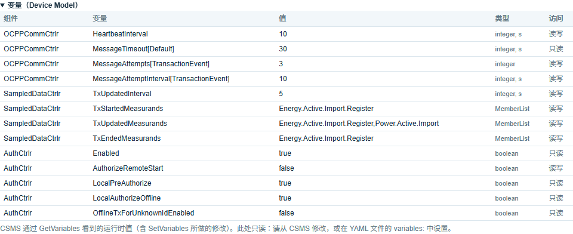

# 快速开始

SME OCPPSim 模拟的是**充电桩（Charge Point）**一侧，需要一个 CSMS（中央系统）供充电桩连接。下面的示例使用开源的
OCPP 1.6 CSMS [SteVe](https://github.com/steve-community/steve)；任何支持 OCPP 1.6J 的 CSMS 都可以。

## Windows 可执行文件

从 [最新发布](https://github.com/smartedge-tech-dev/sme-ocpp-sim/releases/latest) 下载
`sme-ocpp-sim-vX.Y.Z-windows.exe` 并运行。不指定 `-c` 时使用用户目录下的 `%USERPROFILE%\.sme-ocpp-sim\config.yaml`
（首次运行时由内置的演示配置 `configs/demo-site.yaml` 复制生成），并打开 <http://127.0.0.1:8082/> 的 Web UI。
在 Web UI 中保存会写回该文件，因此重启后修改仍然保留；删除该文件即可从演示配置重新开始。指定 `-c FILE` 时使用并
写回该文件。启动时控制台日志会显示正在使用的配置文件（`config file: ...`）。

```powershell
.\sme-ocpp-sim-v0.2.2-windows.exe -c my-site.yaml
```

## pip

需要 Python 3.11 或更高版本：

```powershell
python -m venv .venv
.venv\Scripts\pip install sme-ocpp-sim
.venv\Scripts\sme-ocpp-sim -c my-site.yaml
```

也可以使用 `pipx install sme-ocpp-sim`。

## Docker

GHCR 上发布了 linux/amd64 和 linux/arm64 镜像。容器只暴露 Web UI 端口（8082）：模拟充电桩是主动连接 CSMS 的
WebSocket *客户端*，不需要协议端口。

```bash
docker run --rm -p 8082:8082 ghcr.io/smartedge-tech-dev/sme-ocpp-sim
```

容器内的 `localhost` 指向容器自身，因此演示配置中的 `ws://localhost:8180/...` 连不到你电脑上的 CSMS。
要连接 Docker 宿主机上运行的 CSMS，请在 CSMS URL 中使用 `host.docker.internal`，例如
`ws://host.docker.internal:8180/steve/websocket/CentralSystemService`。Docker Desktop（Windows / macOS）自带这个名称；
在 Linux 上请加上 `--add-host=host.docker.internal:host-gateway`：

```bash
docker run --rm -p 8082:8082 --add-host=host.docker.internal:host-gateway \
  -v "$PWD/site.yaml:/app/configs/site.yaml" \
  ghcr.io/smartedge-tech-dev/sme-ocpp-sim \
  sme-ocpp-sim run -c configs/site.yaml --host 0.0.0.0 --no-browser
```

用 `-e TZ=Asia/Tokyo` 设置时区（默认 UTC）。每个发布都附带可用 `docker load -i` 导入的离线镜像。

## 命令行选项

| 选项 | 含义 |
|---|---|
| `-c, --config FILE` | YAML 配置文件（默认：内置的 `configs/demo-site.yaml`；Windows 可执行文件为 `~/.sme-ocpp-sim/config.yaml`，见上文） |
| `--host 127.0.0.1` | Web UI 绑定地址（默认仅本机；`0.0.0.0` 对局域网开放） |
| `--http-port 8082` | Web UI 端口 |
| `--no-browser` | 启动时不打开浏览器 |
| `-v, --verbose` | 调试日志 |
| `--version` | 显示版本 |

## 首次连接 SteVe

1. 启动 SteVe。演示配置假定其地址为 `ws://localhost:8180/steve/websocket/CentralSystemService`。
2. 在 SteVe 中注册 charge box ID `CP-0001`、`CP-0002`、`CP-0003`。未注册的 ID 会在 WebSocket 握手时被 SteVe 以
   HTTP 404 拒绝，UI 会显示为握手错误。
3. 如果希望 Authorize 返回 Accepted，请注册 OCPP 标签 `04A1B2C3` 和 `TAG-0002`。
4. 启动 SME OCPPSim。每台充电桩连接后发送 BootNotification 和 StatusNotification，之后定期发送 Heartbeat。
5. 在 Web UI 中给 connector 插枪、刷卡并启动交易。MeterValues 会出现在帧日志中，交易会出现在 SteVe 中。
6. 从 SteVe 向正在充电的 connector 下发 SetChargingProfile，在 Smart Charging 面板中观察功率跟随限值变化。

要改用其它 CSMS，请在 YAML 文件或 UI 的设置对话框中修改 `csms_defaults.url`。充电桩 ID 会作为最后一段路径追加到 URL 上。

## OCPP 2.0.1 充电桩 { #ocpp-201 }

2.0.1 充电站需要支持 OCPP 2.0.1（子协议 `ocpp2.0.1`）的 CSMS。`ocpp_version` 按充电桩设置（或在 `csms_defaults`
中为全部设置），因此 1.6 与 2.0.1 充电桩可以各自使用自己的 `csms_url` 同时运行：

```yaml
csms_defaults:
  url: "ws://localhost:8180/steve/websocket/CentralSystemService"   # OCPP 1.6 CSMS
  ocpp_version: "1.6"

chargers:
  - id: "CP-0001"                     # OCPP 1.6J
    max_power_w: 6000
    id_tags: ["04A1B2C3"]
  - id: "CS-2001"                     # OCPP 2.0.1, two EVSEs
    ocpp_version: "2.0.1"
    csms_url: "ws://localhost:9000/ocpp"
    connectors: 2
    max_power_w: 7400
    id_tags: ["04A1B2C3"]
    variables:
      - { component: OCPPCommCtrlr, variable: HeartbeatInterval, value: 120 }
```

完整示例见 [`configs/mixed-site.yaml`](https://github.com/smartedge-tech-dev/sme-ocpp-sim/blob/main/configs/mixed-site.yaml)。请把 2.0.1 的 URL 换成你的 CSMS 的充电站端点；与 1.6 一样，
充电站 ID 会作为最后一段路径追加到 URL 上。版本也可以在 UI 的设置对话框中修改（充电桩会重新连接）。

对 2.0.1 充电桩，Web UI 显示：

- 充电桩列表和详情标题中的 OCPP 版本；
- 用 EVSE 代替 connector（`connectors: N` = N 个 EVSE，每个一个 connector）；
- 用 **变量（Device Model）** 代替配置键：CSMS 通过 GetVariables 读取的运行时值（含 SetVariables 的修改）。
  该表只读（HTTP API 没有修改变量的路由）：请从 CSMS 修改，或在 YAML 文件的 `variables:` 中设置；
- Smart Charging 面板中的 **外部限值（EMS）** 控件，见 [Smart Charging](smart-charging.md#ocpp-201)。

故障对话框列出该充电桩版本的故障码。2.0.1 的 StatusNotification 没有错误码，因此 2.0.1 故障会把 EVSE 报告为
Faulted，故障码只作为被中断交易的 `stoppedReason` 发送。


