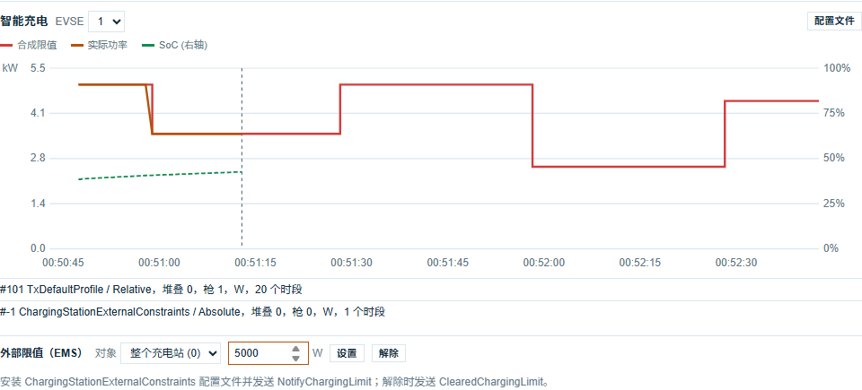

# Smart Charging

SME OCPPSim 实现了 OCPP 1.6 的 Smart Charging：SetChargingProfile、ClearChargingProfile、GetCompositeSchedule，
以及 RemoteStartTransaction 携带的充电 profile。

## 计划与功率使用同一个计算函数

功率模型每个 tick 施加的限值，就是 1 秒长复合计划（composite schedule）的第一个时段，由应答 GetCompositeSchedule
的同一个函数计算。因此报给 CSMS 的计划，与模拟 EV 实际吸收的功率（也就是 MeterValues 中的数值）不会不一致。

每个 tick：复合计划限值 → `min(硬件上限, 限值, EV 可接受功率)` → 功率（如配置了爬坡则按爬坡变化）→ 电能寄存器与 SoC。
新 profile 在 CALLRESULT 发出后的下一个 tick 生效。限值降到 0 或低于 EV 的最小可用功率时，connector 变为 **SuspendedEVSE**；
EV 充满（达到目标 SoC）或衰减到最小值以下时，变为 **SuspendedEV**。

`simulation.time_scale` 只加速功率模型（爬坡、电能、SoC）。充电计划以 CSMS 时间表示，因此 profile 始终按真实时间计算：
Relative 的 60 秒时段在任何 time_scale 下都持续真实的 60 秒。

## 依据规范实现的规则

引用的章节为 OCPP 1.6 edition 2 及其 errata sheet v4.0。

- **3.13.1**：ChargePointMaxProfile 只能用于 connectorId 0；TxProfile 只能用于 connectorId > 0，且仅在该 connector 上有进行中的交易时。
  交易结束时 TxProfile 失效（7.10）。
- **3.13.2 / 5.16.3 / 5.16.4**：新 profile 替换 chargingProfileId 相同、或 stackLevel 与 purpose 都相同的已安装 profile。
- **3.13.2**：每个 purpose 中，有效期内（validFrom / validTo）stackLevel 最高的 profile 生效；其计划未在运行（尚未开始、
  `duration` 已过）时，回落到下一个较低的 stackLevel（errata 3.43）。没有任何 profile 时不限功率。
- **3.13.1 / 3.13.3**：对当前交易，TxProfile 优先于 TxDefaultProfile；结果再与 ChargePointMaxProfile 取较小值。
  connector 专用的 TxDefaultProfile 仅对该 connector 替换同 stackLevel 的 connector 0 profile。
- **7.9 / 7.13**：Absolute 从 `startSchedule` 开始；Relative 以及没有 `startSchedule` 的 Absolute 从交易开始时刻开始；
  Recurring 每天 / 每周重复，`duration` 超过重复周期时截断为周期长度（errata 3.43 / 3.44）。第一个时段从 0 开始（errata 3.45）；
  stackLevel ≥ 0（7.8）。
- **7.12 / 7.14**：W = A × 电压 × 相数，相数取 `numberPhases`，缺省为 3。errata 3.34：profile 的相数多于充电桩时，限值作用于实际可用的相。
- **6.13 / errata 3.25–3.26**：不带字段的 ClearChargingProfile 清除全部；否则按给出的字段取 AND；给出 `id` 时忽略其它字段。
  无匹配 → `Unknown`（7.21）。
- **5.7**：复合计划覆盖 [开始, 开始 + duration)；connectorId 0 报告整台充电桩。
- 无效的 `chargingRateUnit`（与其它无效枚举值一样）应答 CALLERROR `PropertyConstraintViolation`（errata 3.24）。

## 本实现的解释

对于规范没有明确规定的地方，本实现做出如下判断。“已核对章节”是核对过的位置。

| 项目 | 解释 | 已核对章节 |
|---|---|---|
| 无交易时的 Relative | 在没有交易的 connector 上，Relative（以及没有 `startSchedule` 的 Absolute）以请求时间窗口的开始为起点；ChargePointMaxProfile 始终以窗口开始为起点。因此无交易时的实际限值是 Relative 计划的第一个时段 | 5.7、7.13 |
| 没有 `startSchedule` 的 Recurring | 以 00:00 UTC（Daily）或周一 00:00 UTC（Weekly）为基准；重复也会延伸到 `startSchedule` 之前（`startSchedule` 只决定一天 / 一周中的时刻） | 7.8、7.9 |
| validFrom / validTo | validFrom 包含，validTo 不包含 | 7.8 |
| connectorId 0 的复合计划 | min(ChargePointMax, connector 1..N 的 TxProfile / TxDefault 限值之和)；任一 connector 无限制则总和无限制。空闲 connector 也按其 TxDefault 限值计入（没有则使总和无限制），因此该值是充电桩*可能*吸收的最大功率，而不是当前功率。单个 connector 获得完整的 ChargePointMax 值（不在 connector 之间分配） | 5.7、3.13.3 |
| `minChargingRate` | 不改变限值；低于它时拒绝充电是 EV 模型的职责 | 7.13 |
| GetCompositeSchedule 中的“无限制” | 无限制的时段报告为充电桩的硬件上限（`max_power_w`，connectorId 0 时乘以 connector 数），因此即使没有 profile 也应答 Accepted（1.6 没有表示“无限制”的方式） | 5.7 |
| GetCompositeSchedule 的应答 | `scheduleStart` = `chargingSchedule.startSchedule` = 请求时刻；`duration` = 请求的 duration；限值四舍五入到 1 位小数，取整后相等的相邻时段合并。未知 connector 或 duration < 1 → Rejected | 5.7、7.13 |
| 落在整秒之间的时段边界 | 从下一个整秒开始（`startPeriod` 为整数） | 7.13 |
| 未给出单位 | W | 7.13 |
| 以 A 为单位的限值与相数 | EV 充电时作用于 EV 使用的相，否则作用于供电的相 | errata 3.34 |
| 替换范围 | 同 stackLevel + purpose 的替换按 connectorId 区分（connector 专用 TxDefaultProfile 仅“对该 connector”替换 connector 0 的 profile） | 3.13.1 |
| 属于其它交易的 TxProfile | `transactionId` 与 connector 当前交易不一致的 TxProfile → Rejected | 3.13.1 |
| 格式错误的 profile | 没有 `recurrencyKind` 的 Recurring、非递增的 `startPeriod`、空时段列表、0..N 之外的 connectorId、`validTo` ≤ `validFrom` → Rejected | 7.13 |
| schema 未表达的取值范围 | 负的 `limit` / `startPeriod` / `minChargingRate`、1..3 之外的 `numberPhases`、`duration` ≤ 0 → Rejected | 7.13、7.14 |
| RemoteStartTransaction 携带的 profile | 必须是不带 `transactionId` 的 TxProfile（“SHALL NOT be set”），否则不启动交易并应答 Rejected。StartTransaction 得到应答后，绑定新的 transactionId 安装 | 5.16.2、6.33 |
| 超出范围的 connector | connectorId 在 0..N 之外的 SetChargingProfile / ClearChargingProfile 与其它按 connector 寻址的请求一样，应答 CALLERROR `PropertyConstraintViolation` | — |
| 离线期间 | tick 只在连接时运行；离线后的第一步按重连时生效的限值对离线期间积分 | — |

## 功率模型约定

以下是模拟器自身的约定，不是 OCPP 规定：

- 功率 = `相电压 × 电流 × 相数`。三相供电且 `line_to_line: true` 时相电压 = `voltage_v / √3`，即 P = √3 × 线电压 × 电流。
  使用的相数 = min(EV 相数, 供电相数)。
- 电能按梯形法积分，电能寄存器只增不减。SoC 最多会超出目标一个步长。
- 爬坡（`ramp_up_w_per_s`、`ramp_down_w_per_s`）单位为每模拟秒的 W，默认是阶跃变化。

## OCPP 2.0.1 { #ocpp-201 }

2.0.1 充电桩有这套规则的独立副本（`protocol/v201/profiles.py` / `composite.py`）；功率模型共用，因此同样的闭环成立：
GetCompositeSchedule 的值等于随后 TransactionEvent 读数中的 `Power.Active.Import`。消息：SetChargingProfile、
ClearChargingProfile、GetCompositeSchedule、GetChargingProfiles（按 EVSE 与 `chargingLimitSource` 分组，每组一条
ReportChargingProfiles，除最后一条外带 `tbc`）、NotifyChargingLimit、ClearedChargingLimit，以及 RequestStartTransaction
的 `chargingProfile`（绑定到它启动的交易后安装）。

| 项目 | 行为（schema 未规定之处为本实现的解释） |
|---|---|
| Purpose | ChargingStationMaxProfile（仅 evseId 0，不能是 Relative：K01.FR.38）、TxDefaultProfile、TxProfile（evseId > 0，需要该 EVSE 正在进行的交易的 `transactionId`，否则 `TxNotFound`，K01.FR.09）、ChargingStationExternalConstraints（CSMS 不可设置：以 `UnsupportedPurpose` Rejected，errata K01.FR.62） |
| EVSE 的限值 | min(ChargingStationMax、evseId 0 与该 EVSE 的外部约束、TxProfile 否则 TxDefaultProfile) |
| evseId 0 | min(ChargingStationMax、evseId 0 的外部约束、各 EVSE 限值之和)；任一 EVSE 无约束则无约束 |
| stackLevel 冲突 | 相同 EVSE、purpose、stackLevel 且有效期重叠的另一 profile（K01.FR.06）、不论有效期 stackLevel 与 `transactionId` 相同的 TxProfile（K01.FR.39）、evseId 0 与单个 EVSE 上 stackLevel 相同的 TxDefaultProfile（K01.FR.52 / FR.53）以 `DuplicateProfile` Rejected（相同 id 则替换） |
| `chargingSchedule` 数组 | 只能有一个 schedule，多于一个 Rejected（K01.FR.34：仅 ISO 15118 时允许，不模拟）。Absolute / Recurring 必须带 `startSchedule`，Relative 不能带（K01.FR.40 / FR.41） |
| ClearChargingProfile | `chargingProfileId` 优先于条件；条件为 AND；外部约束不会被 CSMS 清除 |
| Device Model | 执行 SmartChargingCtrlr ProfileStackLevel（100）、PeriodsPerSchedule（1024）、RateUnit（`A,W`；其他单位为 `UnsupportedRateUnit`，GetCompositeSchedule 同样，K08.FR.07）；ExternalControlSignalsEnabled 为 `false` 时拒绝外部限值；NotifyChargingLimitWithSchedules 决定 NotifyChargingLimit 是否携带 schedule |

**外部限值。** `POST /api/chargers/{id}/external-limit` 代替能源管理系统：在 EVSE 或整站上安装
ChargingStationExternalConstraints profile（stackLevel 0、单个 W 时段、负数 profile id），并发送 NotifyChargingLimit
（`chargingLimitSource` `EMS`）；解除时发送 ClearedChargingLimit。两者只在 Boot 已被接受时发送（离线时设置的限值会生效，
但之后不再补报）。GetChargingProfiles 以 source `EMS` 上报这些 profile，CSMS 设置的以 `CSO` 上报。OCPP 1.6 没有外部限值，
返回 400。

交易进行中，若外部限值的变更改变了 EVSE 可充电的速率，还会把 TransactionEvent `Updated`（`ChargingRateChanged`）
放入发送队列（K11.FR.04 / K13.FR.03）。

2.0.1 规则已对照 OCPP 2.0.1 Edition 4（Part 2 K01 / K08 / K10 / K11 / K13，errata 2026-09）核对；
需求 id 见 `protocol/v201/profiles.py` 与 `composite.py` 的 docstring。

在 Web UI 中，2.0.1 充电桩的 Smart Charging 面板有一行 **外部限值（EMS）**：选择整个充电站（0）或某个 EVSE，
输入以 W 为单位的限值后点“设置”，或点“解除”。外部约束 profile 随即出现在 profile 列表中，图表中的合成限值也会包含它。

